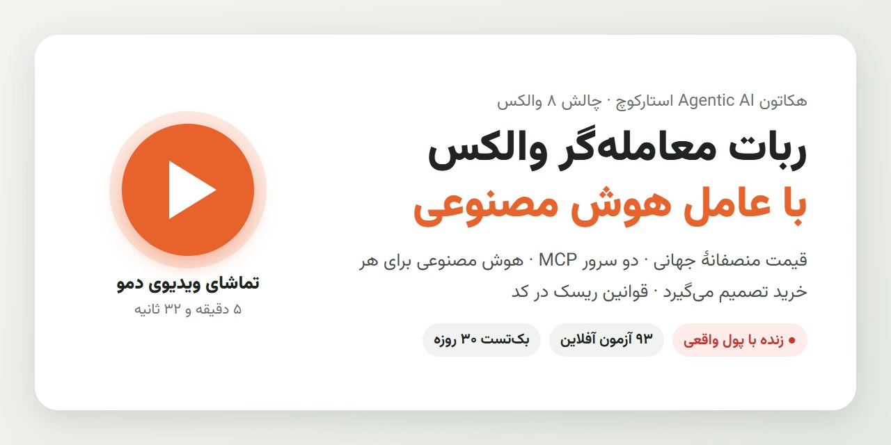
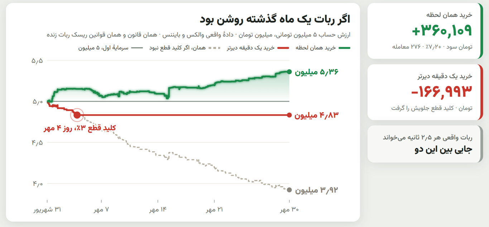
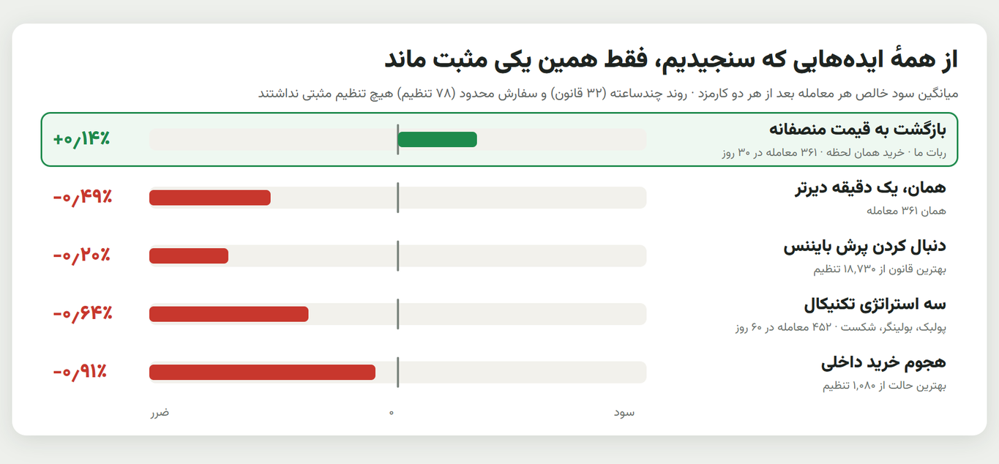

# ربات معامله‌گر والکس با ناظر هوش مصنوعی

<p align="center"><a href="https://ssepehrnoush.github.io/wallex-ai-trader/"></a></p>

<p align="center">
  
  
  
  
  
</p>

ارسال تیم برای چالش والکس در هکاتون Agentic AI استارکوچ (مهر و آبان ۱۴۰۵).

> **در یک جمله:** والکس یک بازار محلی است که قیمت‌های جهانی را با کمی تأخیر دنبال می‌کند. هر وقت بتوان یک کوین را روی والکس به‌وضوح **ارزان‌تر از قیمت منصفانه جهانی** خرید، معمولاً ظرف چند دقیقه به آن قیمت برمی‌گردد. ربات همان لحظه می‌خرد و وقتی فاصله بسته شد می‌فروشد. یک ناظر هوش مصنوعی دوعاملی هر ۳۰ دقیقه آمار زنده همه بازارها را می‌خواند و تصمیم می‌گیرد ربات در کدام بازار، با چه آستانه و چه اندازه‌ای کار کند. قوانین ریسک داخل کد است و هوش مصنوعی نمی‌تواند دورشان بزند.

> **ویدیوی دمو (۵ دقیقه و ۳۲ ثانیه):** [▶ تماشای آنلاین](https://ssepehrnoush.github.io/wallex-ai-trader/) · [دانلود wallex-demo.mp4](https://github.com/ssepehrnoush/wallex-ai-trader/releases/download/demo-video/wallex-demo.mp4)
>
> **داشبورد ربات زنده (رابط کاربری، فقط نمایش):** [📊 باز کردن داشبورد](https://ssepehrnoush.github.io/wallex-ai-trader/dashboard.html): ارزش حساب، معامله‌ها، فاصلهٔ هر بازار تا آستانهٔ خرید، و هر بازبینی هوش مصنوعی با ابزارهایی که صدا زد.

## خلاصه برای داور (۲ دقیقه)

| | |
|---|---|
| **منطق** | قیمت منصفانه = قیمت بایننس × نرخ تتر والکس. وقتی قیمت فروش والکس دست‌کم ۰٫۷٪ (کف کارمزد رفت‌وبرگشت) زیر فاصلهٔ عادی همان بازار با قیمت منصفانه باشد، فرصت خرید است؛ وقتی فاصله بسته شد می‌فروشد. ۸ بازار تومانی، حساب واقعی ۵ میلیون تومانی هکاتون ([منطق استراتژی](#منطق-استراتژی)). |
| **هوش مصنوعی کجاست** | دو سطح. (۱) هر ۳۰ دقیقه یک ایجنت تحلیلگر با **دو سرور MCP** (MCP رسمی والکس با ۴ ابزار فقط‌خواندنی و بدون کلید، و MCP خود موتور) شواهد را خودش جمع می‌کند و سیاست هر بازار را می‌دهد؛ افسر ریسک فقط می‌تواند سخت‌گیرترش کند. (۲) از ۳۰ مهر عصر **عامل معامله** هر خرید را تصمیم می‌گیرد: کد فقط فرصت را پیدا می‌کند و پرونده می‌فرستد، مدل «بخر» یا «نخر» را با دلیل می‌گوید، و جواب دیرتر از ۲۰ ثانیه یعنی خرید نمی‌شود ([نقش هوش مصنوعی](#نقش-هوش-مصنوعی)). |
| **ریسک در کد، نه در پرامپت** | ریسک هر معامله ۰٫۶٪ سرمایه، حداکثر ۳ موقعیت، توقف روزانه با ۱٫۵٪ ضرر، **کلید قطع با ۳٪ افت**، محافظ سود وقتی حساب جلو است، و سقف ضرر مسابقه ۰٫۴٪. مدل به ابزار ثبت سفارش دسترسی ندارد و همهٔ عددهایش به بازهٔ مجاز بسته می‌شود ([مدیریت سرمایه و ریسک](#مدیریت-سرمایه-و-ریسک)، [SECURITY.md](SECURITY.md)). |
| **صادقانه** | روی دفتر سفارش واقعی لبهٔ مطمئنی بعد از کارمزد پیدا نکردیم: بک‌تست ۳۰ روزه با ورود همان لحظه +۷٫۲٪ است ولی با ورود یک دقیقه دیرتر ضرر می‌دهد، و بازپخش ۱۶ ساعت دفتر سفارش زنده با همهٔ بازارها روشن سه ورود داشت و هر سه ضرر. چهار خانوادهٔ دیگر (روند، دنبال کردن بایننس، هجوم خرید داخلی، سفارش محدود) هم سنجیده و رد شدند. پس طراحی نهایی شانس پایان مثبت را بالا می‌برد و ضرر را کوچک و محدود نگه می‌دارد ([RESULTS.md](RESULTS.md) بخش‌های ۲.۶، ۲.۷، ۷ تا ۱۰). |
| **هر تصمیم قابل ردیابی است** | هر بازبینی، هر ابزاری که مدل صدا زد، هر «بخر» یا «نخر» و هر ورود و خروج با دلیل فارسی در `runs/<run>/decisions.jsonl` است؛ داشبورد ثابت: `dashboard/snapshot_live_main.html` ([لاگ تصمیم‌ها](#لاگ-تصمیمها)). |
| **اجرای دوباره** | بدون کلید و بدون شبکهٔ صرافی: `python scripts/test_trade_agent.py` (۲۹ آزمون)، `test_contest_mode.py` (۲۳)، `test_gain_guard.py` (۱۳)، `test_live_paths.py` (۱۹)، و بک‌تست ۳۰ روزه با یک دستور ([اجرای دوباره](#اجرای-دوباره-برای-داوران)). |

اگر ربات یک ماه گذشته روشن بود (بک‌تست ۳۰ روزه روی حساب ۵ میلیونی با خود قوانین ریسک ربات، [RESULTS.md](RESULTS.md) بخش ۲.۶)، و میانگین سود خالص هر معامله در همهٔ ایده‌هایی که سنجیدیم (بخش ۱۰):

<p align="center"></p>
<p align="center"></p>

---

## فهرست

1. [منطق استراتژی](#منطق-استراتژی)
2. [معماری](#معماری)
3. [نقش هوش مصنوعی](#نقش-هوش-مصنوعی)
4. [شرایط خرید و فروش](#شرایط-خرید-و-فروش)
5. [مدیریت سرمایه و ریسک](#مدیریت-سرمایه-و-ریسک)
6. [بک‌تست و تست سایه](#بکتست-و-تست-سایه)
7. [تاریخچه کد زنده](#تاریخچه-کد-زنده)
8. [لاگ تصمیم‌ها](#لاگ-تصمیمها)
9. [اجرای دوباره (برای داوران)](#اجرای-دوباره-برای-داوران)
10. [استراتژی‌ای که امتحان کردیم و کنار گذاشتیم](#استراتژیای-که-امتحان-کردیم-و-کنار-گذاشتیم)
11. [چک‌لیست امنیت ایجنت (شش سؤال کارگاه AI Governance)](SECURITY.md)

---

## منطق استراتژی

```
قیمت منصفانه (بازار تومانی) = قیمت جهانی کوین به تتر (میانه دفتر سفارش بایننس) × نرخ تتر/تومان والکس
قیمت منصفانه (بازار تتری)  = قیمت جهانی کوین به تتر
پریمیوم                    = قیمت میانه والکس ÷ قیمت منصفانه − ۱
خط پایه                     = میانه پریمیوم همان بازار در ۳ ساعت اخیر
انحراف خرید (buy_dev)      = قیمت فروشنده (ask) ÷ قیمت منصفانه − ۱ − خط پایه
انحراف فروش (sell_dev)     = قیمت خریدار (bid) ÷ قیمت منصفانه − ۱ − خط پایه
```

- هر بازار پریمیوم «عادی» خودش را دارد (مثلاً در اجرای زنده تا ۰۰:۵۰ بامداد ۳۰ مهر، خط پایه بیت‌کوین تومانی حدود ۰٫۰۵٪ تا ۰٫۲۳٪ زیر قیمت جهانی بود و بی‌ان‌بی تومانی حدود ۰٫۱۷٪ تا ۰٫۴۴٪ بالای آن؛ ستون `baseline` در `ticks.csv`). برای همین با خط پایه همان بازار مقایسه می‌کنیم، نه با صفر. پس «ارزان» یعنی ارزان‌تر از فاصلهٔ عادی همان بازار با قیمت منصفانه.
- خط پایه وقتی آماده است که دست‌کم ۲۴۰ نمونه (حدود ۱۰ دقیقه تیک) داشته باشد. بعد از ری‌استارت، از تیک‌های ضبط‌شده ۳ ساعت اخیر دوباره پر می‌شود و ربات با خط پایه سرد معامله نمی‌کند. در کد این ریپو این گرم‌کردن فقط تیک اجراهای واقعی (`live_` و `shadow_`) را می‌خواند، نه تیک‌های ساختگی آزمون. پروسهٔ زنده این اصلاح را از اولین راه‌اندازی بعد از ادغام این نسخه دارد (یادداشت زیر [جدول ابزارها](#تحلیلگر-ابزارمحور-با-دو-سرور-mcp)).
- ربات واقعی ۸ بازار تومانی را معامله می‌کند: BTC، ETH، SOL، XRP، DOGE، PEPE، BNB و ARB (`fairvalue.live_symbols` در `config.json`). بازارهای تتری فقط در تست سایه و بک‌تست سنجیده شدند.
- دو بازار تومانی POL و SAND «در حال تماشا» هستند (`fairvalue.watch_symbols`). ربات دفتر سفارششان را از اولین تیک ثبت می‌کند ولی خاموش شروع می‌شوند. در بک‌تست ۷ روزه با قانون خروج زنده سود دادند (POL با ۵۹ معامله، میانگین +۰٫۷۸٪؛ SAND با ۲۲ معامله، +۰٫۴۳٪)، ولی با ورود یک دقیقه دیرتر میانگینشان −۰٫۵٪ شد. پس کد، نه پرامپت، فقط وقتی روشنشان می‌کند که بازپخش تیک‌های زندهٔ خودشان در ۸ ساعت اخیر با سیاست همان لحظه دست‌کم یک معامله و جمع مثبت بدهد (`supervisor.py`؛ تست: `scripts/test_watch_gate.py`). آن عددهای ۷ روزه با اسپرد باریک‌تر یک عکس فوری دفتر سفارش حساب شده بودند. اسپرد زندهٔ این دو بازار (میانهٔ تیک‌های ۳۰ مهر: POL ۲٫۲۰٪ و SAND ۰٫۶۱٪) از سقف ۰٫۶٪ موتور بیشتر است و بک‌تست ۳۰ روزه با همین اسپردها هیچ ورودی نمی‌دهد ([RESULTS.md](RESULTS.md) بخش ۲.۶).
- انحراف با **قیمت قابل اجرا** حساب می‌شود (ask برای خرید، bid برای فروش). یعنی اسپرد از اول در محاسبه هست و سود ساختگیِ ناشی از نوسان بین bid و ask نداریم.
- **چرا باید جواب بدهد (فرضیه):** تریدرهای جهانی زودتر به خبر و حرکت قیمت واکنش نشان می‌دهند. دفتر سفارش والکس کم‌عمق‌تر است و چند ثانیه تا چند دقیقه عقب می‌ماند. وقتی یک فروشنده بزرگ روی والکس قیمت را پایین می‌کشد ولی قیمت جهانی تغییری نکرده، آربیتراژکارها قیمت را برمی‌گردانند. این هنوز فرضیه است: در بک‌تست، ورود یک دقیقه دیرتر میانگین را منفی می‌کند و اجرای زنده هنوز شاهدی برایش نداده است ([RESULTS.md](RESULTS.md) بخش ۲.۲، «لبهٔ سود چقدر شکننده است»).

## معماری

```
            ┌──────────────── هر ۲٫۵ ثانیه ────────────────┐
 Binance ──►│ GlobalFeed ─┐                                  │
 (OKX پشتیبان)            ├─► fair value ─► PremiumTracker ─┤
 Wallex  ──►│ WallexBooks ┘   (fairvalue.py)  (خط پایه)      │
            │                                                │
            │   انحراف خرید/فروش ─► ورود/خروج ─► Executor    │──► Wallex API
            │        ▲                  ▲     (shadow | live)│
            └────────┼──────────────────┼────────────────────┘
                     │ سیاست هر بازار   │ سقف‌های سخت
        ┌────────────┴─────┐   ┌────────┴────────┐
        │ ناظر AI (هر ۳۰د) │   │  RiskManager    │
        │ تحلیلگر ─► افسر  │   │  (risk.py)      │
        │ ریسک (supervisor)│   └─────────────────┘
        └──────────────────┘
                     همه رویدادها ─► runs/<run>/decisions.jsonl
```

| فایل | کار |
|---|---|
| `wallexbot/client.py` | کلاینت REST والکس (داده عمومی، سفارش، لغو، وضعیت) |
| `wallexbot/feeds.py` | دفتر سفارش والکس (موازی) و قیمت جهانی (بایننس، با OKX به‌عنوان پشتیبان) |
| `wallexbot/fairvalue.py` | قیمت منصفانه، خط پایه پریمیوم، سیاست هر بازار |
| `wallexbot/supervisor.py` | ناظر هوش مصنوعی دوعاملی |
| `wallexbot/agent.py` | ایجنت تحلیلگر ابزارمحور که به دو سرور MCP وصل می‌شود |
| `wallexbot/mcp_server.py`, `wallexbot/tools.py` | سرور MCP موتور و ابزارهای فقط‌خواندنی آن |
| `wallexbot/ai.py` | اتصال به مدل زبانی (BoxAPI، با OpenAI به‌عنوان پشتیبان) و کش پاسخ‌ها |
| `wallexbot/risk.py` | قوانین سخت ریسک |
| `wallexbot/engine.py` | حلقه زنده، اجراکننده سایه و واقعی |
| `wallexbot/journal.py` | لاگ تصمیم‌ها |
| `wallexbot/report.py` | داشبورد HTML یک اجرا (فارسی، فقط‌خواندنی نسبت به پوشه اجرا) |
| `config.json`, `wallexbot/config.py` | همه تنظیمات؛ کلیدها فقط از `../.env` خوانده می‌شوند |
| `scripts/premium.py` | پژوهش: آیا والکس از قیمت جهانی عقب می‌ماند؟ |
| `scripts/bt_fairvalue.py` | بک‌تست همین قانون روی داده دقیقه‌ای، در یک پنجرهٔ ثابت (پیش‌فرض ۷ روز؛ ۳۰ روز با `--candle-dir research/candles_30d --days 30`). `--live-exit` قانون خروج، کف کارمزد و سقف اسپرد موتور زنده را اعمال می‌کند، `--max-drop` فیلتر ریزش ۶۰ ثانیه‌ای را، و `--spreads-json` اسپردهای ثبت‌شده را می‌خواند. هر اجرا ورود در دقیقهٔ بعد را هم بازپخش می‌کند. API والکس را صدا نمی‌زند |
| `scripts/bt_toman.py` | نتیجهٔ یک بک‌تست را به تومان می‌برد: معامله‌ها را به ترتیب زمان روی یک حساب ۵ میلیونی با خود `risk.py` بازپخش می‌کند (`toman.json`) |
| `scripts/bt_live_overlap.py` | ورودهای بک‌تست را در ساعت‌هایی که دفتر سفارش زنده هم ضبط شده با دفتر واقعی مقایسه می‌کند |
| `scripts/live_tick_replay.py` | قانون ورود و خروج را روی دفتر سفارش ضبط‌شدهٔ اجرای زنده بازپخش می‌کند، با همهٔ بازارها روشن |
| `scripts/bt_gain_guard.py`, `scripts/test_gain_guard.py` | اثر محافظ سود (و با `--loss-budget` سقف ضرر مسابقه) روی بازه‌های هم‌اندازهٔ مسابقه، و تست آفلاین خود قانون |
| `wallexbot/trader.py`, `scripts/test_trade_agent.py` | عامل معامله: مدل هر خرید را تصمیم می‌گیرد، و تست آفلاینش از راه مسیر خرید خود موتور |
| `scripts/test_contest_mode.py` | تست آفلاین حالت پایان مسابقه: بازار سالم روشن می‌ماند، سقف آستانه و اندازه، مشکل ساختاری، halt، بازارهای تماشایی و سقف ضرر |
| `research/fetch_candles.py` | دانلود کندل از API عمومی والکس، بدون کلید (`--end` برای پنجرهٔ ثابت) |
| `research/live_spreads.py`, `research/live_spreads_watch.py` | اسپرد میانهٔ هر بازار از تیک‌های ضبط‌شده (ورودی `--spreads-json`)؛ دومی برای POL و SAND |
| `scripts/test_live_paths.py` | ۱۹ آزمون مسیرهای حالت واقعی با صرافی ساختگی؛ کاملاً آفلاین (بدون کلید، بدون شبکه و بدون سفارش واقعی) |
| `scripts/bt.py`, `scripts/edge.py` | بک‌تست ۶۰روزه استراتژی‌های تکنیکال (رد شدند؛ کدشان در `wallexbot/strategy.py` و `backtest.py`) |
| `scripts/bt_wick.py` | آزمون سفارش خرید از پیش گذاشته‌شده برای گرفتن افت‌های چندثانیه‌ای (نتیجه دوپهلو بود؛ کنار گذاشته شد) |
| `research_smart/` | چهار خانوادهٔ «معاملهٔ هوشمند» که سنجیدیم و رد کردیم: روند چندساعته، دنبال کردن پرش بایننس، هجوم خرید داخلی و سفارش محدود؛ اسکریپت‌ها و `results.json` هر کدام ([RESULTS.md](RESULTS.md) بخش ۱۰) |

## نقش هوش مصنوعی

هوش مصنوعی در دو سطح تصمیم می‌گیرد. هر ۳۰ دقیقه **تعیین می‌کند ربات کجا و با چه شدتی معامله کند** (بندهای ۱ تا ۴)، و از ۳۰ مهر عصر **هر خرید را هم خودش تصمیم می‌گیرد** (عامل معامله، بند ۵). فرصت آربیتراژی در چند ثانیه بسته می‌شود، پس کد هر ۲٫۵ ثانیه فرصت را پیدا می‌کند و مدل در حدود ۳ ثانیه می‌گوید بخرد یا نه. سفارش را همیشه کد ثبت می‌کند:

1. **تحلیلگر کمّی (Quant Analyst):** هر ۳۰ دقیقه فقط سیاست فعلی همه بازارها و حرکت جهانی بیت‌کوین و اتریوم را می‌گیرد (`supervisor.py`). بقیهٔ شواهد را خودش با ابزارهای دو سرور MCP جمع می‌کند و خودش انتخاب می‌کند چه چیزی را بخواند (جدول پایین).
   - در پنج بازبینی زنده با gpt-5.6-sol (تا ساعت ۰۰:۴۹ بامداد ۳۰ مهر به وقت تهران) معمولاً این‌ها را صدا زد: `list_markets`، حرکت جهانی، وضعیت ریسک، بک‌تست، `simulate_threshold` برای هر ۸ بازار، و دفتر سفارش و معاملات اخیر والکس فقط برای ۲ تا ۴ بازار.
   - `get_premium_stats` را در چهار بازبینی اول این مدل اصلاً صدا نزد و در پنجمی برای هر ۸ بازار.

   بعد برای هر بازار سیاست پیشنهاد می‌دهد: روشن یا خاموش، آستانهٔ ورود، حد ضرر، حداکثر زمان نگه‌داری و اندازه.
2. **افسر ریسک (Risk Officer):** پیشنهاد تحلیلگر را همراه آمار هر بازار از خود موتور می‌گیرد:
   - آمار ۲ ساعت اخیر: چند دقیقه ارزانی عمیق‌تر از ۰٫۳٪، ۰٫۵٪ و ۰٫۸٪ رخ داده و صدک‌های انحراف؛
   - اسپرد و عمق ردیف اول دفتر سفارش، در لحظهٔ بازبینی؛
   - معامله‌های اخیر ربات؛
   - حرکت جهانی بیت‌کوین و اتریوم در ۱۰ دقیقهٔ اخیر؛
   - بک‌تست مرجع.

   اگر حلقهٔ ابزارمحور خطا بدهد، تحلیلگر تک‌مرحله‌ای جایگزین هم همین آمار را می‌گیرد. افسر **فقط می‌تواند سخت‌گیرتر کند**: آستانه را بالاتر ببرد، اندازه را کم کند یا بازاری را خاموش کند. دلیلش را هم به فارسی می‌نویسد.
3. **کد:** این‌که افسر فقط سخت‌گیرتر کند در کد هم اجباری است، نه فقط در پرامپت. هر عدد هم به بازهٔ مجاز بسته می‌شود. کف آستانهٔ ورود همیشه دو برابر کارمزد تیکر به‌علاوهٔ ۰٫۱٪ است (۰٫۷٪ برای بازارهای تومانی). در حالت `defensive` ضریب اندازه حداکثر ۰٫۴ می‌شود و در حالت `halt` همه بازارها خاموش می‌شوند.
4. **حالت پایان مسابقه (از ۳۰ مهر بعدازظهر، بخش `contest` در `config.json`):** امتیاز سود مسابقه فقط به بازدهی مثبت می‌رسد و رباتی که معامله نکند فقط صفر تمام می‌کند. پس کد اجازه می‌دهد هوش مصنوعی یک بازار زنده را فقط وقتی خاموش کند که خود کد در دادهٔ همان بازبینی مشکل ساختاری ببیند: دادهٔ تازه نیست، اسپرد بالای ۰٫۶٪ است، یا ردیف اول دفتر از حداقل سفارش کمتر است. آستانه حداکثر ۱٪ و ضریب اندازه بین ۰٫۲ و ۰٫۳ می‌ماند. هر تغییری که کد در پیشنهاد هوش مصنوعی می‌دهد، با تصمیم خود هوش مصنوعی کنارش، در `contest_adjustments` بازبینی ثبت می‌شود و به خود مدل هم گفته می‌شود. «halt» هوش مصنوعی و دروازهٔ بازارهای تماشایی سر جایشان‌اند ([RESULTS.md](RESULTS.md) بخش ۸).
5. **عامل معامله (روشن از ۳۰ مهر عصر؛ بخش `trade_agent` در `config.json`):** موتور دیگر خودش نمی‌خرد. هر فرصتی که قانون پیدا کند با یک پرونده (دفتر سفارش، عمق و طول ارزانی، ارزانی ۱۰ دقیقهٔ اخیر، حرکت قیمت جهانی، دفتر تتر، وضع حساب، معامله‌های اخیر و بک‌تست همان بازار) به مدل می‌رود و **مدل تصمیم می‌گیرد بخرد یا نه**، با چه اندازه‌ای و به چه دلیل. خرید فقط با جواب «بخر» تازه و وقتی فرصت هنوز هست انجام می‌شود؛ جواب نیامده یا دیر یعنی خرید نمی‌شود، و همهٔ قانون‌های ریسک مثل قبل اعمال می‌شوند (`wallexbot/trader.py`؛ [RESULTS.md](RESULTS.md) بخش ۹).

### تحلیلگر ابزارمحور با دو سرور MCP

ایجنت تحلیلگر (`wallexbot/agent.py`) هم‌زمان به **دو سرور MCP** وصل می‌شود:

1. **MCP رسمی والکس** (`https://api.wallex.ir/mcp`، از نوع Streamable HTTP). داده خام والکس را از خود والکس می‌گیرد: دفتر سفارش (`wallex_basic_get_market_depth`)، معاملات اخیر (`wallex_basic_get_latest_trades`)، کندل‌ها (`wallex_basic_candle_history`) و قیمت آنی (`wallex_otc_get_otc_price`).
   - این سرور ده‌ها ابزار دارد، از جمله ثبت سفارش. در کد **فقط همین چهار ابزار عمومی و فقط‌خواندنی** (`WALLEX_ALLOWED` در `agent.py`) در اختیار مدل گذاشته می‌شود و هیچ کلید API هم برایش فرستاده نمی‌شود.
   - پس مدل به ابزارهای ثبت سفارش، انتقال وجه و حساب **دسترسی ندارد.** اگر مدل ابزار دیگری را صدا بزند، کد ردش می‌کند.
2. **MCP موتور ربات** (`wallexbot/mcp_server.py`، از نوع stdio). کارهایی را می‌کند که MCP والکس ندارد: مقایسه با قیمت جهانی، آمار پریمیوم، بازپخش آستانه روی تیک‌های زنده، و وضعیت ریسک. همه ابزارهایش **فقط‌خواندنی‌اند** (`wallexbot/tools.py`). در کد این ریپو ابزارهایی که تیک می‌خوانند فقط تیک اجراهای واقعی (`live_` و `shadow_`) را می‌بینند (یادداشت زیر جدول):

| ابزار | چه می‌دهد |
|---|---|
| `list_markets` | بازارها، سیاست فعلی، پریمیوم عادی، کارمزد رفت‌وبرگشت با دو کارمزد تیکر (۰٫۶٪ تومانی، ۰٫۲۶٪ تتری) |
| `get_premium_stats` | چند دقیقه و تا چه عمقی والکس ارزان‌تر از فاصلهٔ عادی‌اش با قیمت جهانی بوده |
| `get_orderbook` | دفتر سفارش زنده والکس (وقتی MCP رسمی وصل است، این ابزار حذف می‌شود و دفتر سفارش از خود والکس می‌آید) |
| `get_fair_value` | قیمت منصفانه جهانی و فاصله bid و ask والکس با آن |
| `get_global_momentum` | تغییر قیمت جهانی بیت‌کوین و اتریوم در ۵، ۱۵ و ۶۰ دقیقه |
| `get_recent_trades` | معامله‌های اخیر ربات، فقط به درصد |
| `get_backtest` | بک‌تست ۷ روزهٔ ۸ بازار تومانی با قانون زنده (`runs/backtests/fv_live_rule_0.007`) و یادداشت هشدارهایش. کنار عدد هر بازار، میانگین همان بازار با ورود یک دقیقه دیرتر (`next_minute_mean_ret_pct`) و تعداد معامله‌های با نرخ تتر کهنه هم می‌آید؛ بازاری که در آن نیست `not_tested` می‌گیرد |
| `simulate_threshold` | **بازپخش تیک‌های ضبط‌شده زنده با یک آستانه پیشنهادی، با همان قانون خرید و فروش موتور:** فیلتر اسپرد، کف کارمزد، و خروج به ترتیب حد ضرر، هدف و زمان. فیلتر ریزش ۶۰ ثانیه‌ای، استراحت بعد از ضرر و پر شدن ناقص را مدل نمی‌کند، و حد ضرر و خروج زمانی را روی خود bid حساب می‌کند، نه ۰٫۳٪ زیر آن. هوش مصنوعی فرضیه‌اش را قبل از اعمال امتحان می‌کند |
| `get_risk_state` | بازده، افت، وضعیت توقف |

**یادداشت:** چهار مورد از این بخش در کد این ریپو تازه اصلاح شده‌اند و پروسهٔ زنده تا برش ۰۰:۵۰ بامداد ۳۰ مهر هنوز نسخهٔ قبلی را داشت:
- فیلتر تیک‌ها (فقط `live_` و `shadow_`) در ابزارها و در گرم‌کردن خط پایه؛
- قانون موتور در `simulate_threshold`؛
- کارمزد ۰٫۶٪ در `list_markets` (نسخهٔ قبلی ۰٫۵۵٪ می‌گفت)؛
- فایل بک‌تست `fv_live_rule_0.007` در `get_backtest` (نسخهٔ قبلی `fv_sweep_0.006_0.0035` را می‌داد).

بعد از ادغام این نسخه در پوشهٔ ربات زنده، ابزارها از اولین بازبینی بعدی فعال می‌شوند، چون سرور MCP موتور در هر بازبینی از نو اجرا می‌شود. گرم‌کردن خط پایه و متن پرامپت‌ها از راه‌اندازی بعدی فعال می‌شوند ([RESULTS.md](RESULTS.md) بخش ۴.۶).

مدل زبانی خودش تصمیم می‌گیرد کدام ابزار از کدام سرور را صدا بزند. در بازبینی اجرای واقعی ساعت ۱۷:۵۵ UTC روز ۲۹ مهر، قبل از تعیین سیاست، ۲۲ بار ابزار صدا زد:
- ۶ بار از MCP رسمی والکس: دفتر سفارش و معاملات اخیر؛
- ۱۶ بار از MCP موتور: شبیه‌سازی آستانه، آمار پریمیوم، قیمت منصفانه، حرکت جهانی، معامله‌های اخیر و وضعیت ریسک.

تا ساعت ۰۰:۵۰ بامداد ۳۰ مهر به وقت تهران (۲۱:۲۰ UTC روز ۲۱ اکتبر)، ۱۲ بازبینی اجرای واقعی روی هم ۲۴۶ بار ابزار صدا زدند: ۱۷۸ بار از MCP موتور و ۶۸ بار از MCP رسمی والکس، یعنی ۱۳ تا ۲۹ فراخوانی در هر بازبینی. اولین بازبینی هنوز MCP رسمی نداشت (بخش [تاریخچه کد زنده](#تاریخچه-کد-زنده)).

اگر MCP رسمی در دسترس نباشد، ایجنت با سرور موتور ادامه می‌دهد.

همه این فراخوانی‌ها با ورودی و خلاصه خروجی در `policy_review.analyst_tool_calls` لاگ می‌شوند. هیچ ابزاری نمی‌تواند سفارش بدهد یا کلید و موجودی برگرداند. همین سرور را می‌شود به Claude Desktop یا Cursor هم وصل کرد تا ربات را از بیرون بررسی کنند (طرز اتصال در `mcp_server.py` آمده است).

اگر هوش مصنوعی در دسترس نباشد، ربات سیاست قبلی را نگه می‌دارد و ضریب اندازه را حداکثر ۰٫۳ می‌کند (حالت امن). اگر حلقه ابزارمحور روی هر دو سرویس خطا بدهد، تحلیلگر تک‌مرحله‌ای جایش را می‌گیرد. هر بازبینی با استدلالش در لاگ ثبت می‌شود و هر معامله به سیاستی که اجازه‌اش را داده قابل ردیابی است.

**مدل:** `openai/gpt-6-sol` از راه BoxAPI، درگاه اسپانسر (`ai.provider` برابر `boxapi` و `ai.boxapi_model` در `config.json`). OpenAI فقط پشتیبان است: اگر BoxAPI جواب ندهد و کلید OpenAI هم تعریف شده باشد، همان مدل (`ai.model` برابر `gpt-6-sol`) مستقیم از OpenAI صدا زده می‌شود (`ai.fallback`). این پشتیبان برای هر دو مسیر کار می‌کند: فراخوانی تک‌مرحله‌ای (افسر ریسک و تحلیلگر پشتیبان) و حلقهٔ ابزارمحور MCP. پاسخ‌های تک‌مرحله‌ای با هش ورودی در `runs/ai_cache_live/` کش می‌شوند و ردپای حلقه ابزارمحور در خود `decisions.jsonl` می‌ماند.

پروسهٔ زنده این مدل را در راه‌اندازی بعدی بارگذاری می‌کند. بازبینی‌های زنده تا راه‌اندازی ساعت ۲۲:۴۴ به وقت تهران با gpt-5.4-mini انجام شدند و از آن به بعد، تا ساعت ۰۰:۵۰ بامداد ۳۰ مهر، با gpt-5.6-sol (جدول [تاریخچه کد زنده](#تاریخچه-کد-زنده)). پشتیبان OpenAI در اجرای زنده هم کار کرده است: در بازبینی ۰۰:۴۹ بامداد، برچسب `analyst_model` پیشوند `openai/` ندارد. یعنی حلقهٔ ابزارمحور روی BoxAPI خطا داد و همان ایجنت با همان مدل روی OpenAI اجرا شد (`analyst_with_tools` در `agent.py` برچسب مدلی را می‌نویسد که جواب داده است).

## شرایط خرید و فروش

| رویداد | شرط |
|---|---|
| **خرید** | بازار در سیاست فعال است، خط پایه آماده است، `buy_dev ≤ −max(entry_dev, کف)`، اسپرد ≤ ۰٫۶٪، قیمت جهانی همان کوین در ۶۰ ثانیه اخیر بیش از ۰٫۴٪ نریخته، و مدیر ریسک اجازه می‌دهد. سفارش خرید LIMIT به قیمت ask است و حجمش به اولین ردیف فروش دفتر سفارش محدود می‌شود |
| **فروش با سود** | `sell_dev ≥ −exit_slack` (فاصله بسته شده) **و** `bid ≥ قیمت خرید × (۱ + ۲ × کارمزد تیکر + ۰٫۰۵٪)`، یعنی در بازار تومانی دست‌کم ۰٫۶۵٪ بالاتر از قیمت خرید (فروش «هدف» هیچ‌وقت بعد از کارمزد ضرر قفل نمی‌کند) |
| **حد ضرر** | bid به `قیمت خرید × (۱ − stop_pct)` برسد (پیش‌فرض ۰٫۹٪) |
| **خروج زمانی** | نگه‌داری بیش از `max_hold_min` دقیقه (پیش‌فرض ۲۵) |
| **پایان مسابقه** | ۱۵۰ دقیقه قبل از پایان، ورود جدید ممنوع است و ۷۵ دقیقه قبل از پایان همه چیز به تومان فروخته می‌شود |

همه فروش‌ها سفارش LIMIT روی bid هستند. حد ضرر، خروج زمانی و فروش پایانی قیمت را ۰٫۳٪ زیر bid می‌گذارند تا مثل سفارش بازار پر شوند.

کف آستانه ورود (در کد): دو برابر کارمزد تیکر + ۰٫۱٪، چون خرید و فروش هر دو تیکر هستند. کارمزد بازارهای تومانی ۰٫۲۵٪ میکر و ۰٫۳٪ تیکر است، پس رفت‌وبرگشت با دو تیکر ۰٫۶٪ می‌شود و کف ۰٫۷٪. برای بازارهای تتری (۰٫۱۳٪ تیکر) کف ۰٫۳۶٪ است. این کف هم در `supervisor.py` روی سیاست هوش مصنوعی اعمال می‌شود و هم در `engine.py` لحظه خرید، پس هیچ سیاستی (پیش‌فرض، قدیمی یا هوش مصنوعی) نمی‌تواند زیر آن بخرد. پروسهٔ زنده کف موتور را از راه‌اندازی ساعت ۲۲:۴۴ به وقت تهران دارد ([تاریخچه کد زنده](#تاریخچه-کد-زنده)).

## مدیریت سرمایه و ریسک

همه این قوانین در `risk.py` است و هوش مصنوعی فقط می‌تواند اندازه را **کوچک‌تر** کند:

- ریسک هر معامله ۰٫۶٪ سرمایه × ضریب اندازهٔ هوش مصنوعی (۰ تا ۱)؛
- اندازه سفارش = این ریسک ÷ (حد ضرر + کارمزد تیکر + کارمزد میکر). مثلاً با سرمایه ۵ میلیون تومان، ضریب ۰٫۴ و حد ضرر ۰٫۹٪ حدود ۸۲۸ هزار تومان می‌شود؛ سفارش زیر ۶۰ هزار تومان فرستاده نمی‌شود؛
- هر موقعیت حداکثر ۳۵٪ سرمایه، کل موقعیت‌ها حداکثر ۷۰٪، و حداکثر ۳ موقعیت همزمان (**هرگز ورود با کل پول**)؛
- بعد از ۱٫۵٪ ضرر روزانه، تا پایان روز (به وقت تهران) ورود جدید ممنوع است؛
- **کلید قطع:** اگر افت حساب از اوج به ۳٪ برسد، ورود جدید کاملاً متوقف می‌شود؛
- قفل سود: از +۳٪ به بعد ریسک هر معامله نصف می‌شود تا رتبه حفظ شود؛
- بعد از هر ضرر، آن بازار ۲ ساعت استراحت می‌کند؛
- حجم سفارش خرید به عمق اولین ردیف فروش دفتر سفارش محدود می‌شود؛
- **محافظ سود** (از ۳۰ مهر): وقتی حساب جلو است، سفارش تازه حداکثر آن‌قدر است که حتی با ۴٪ ضرر، دست‌کم نیمی از سود بماند؛ اگر این سقف از کوچک‌ترین سفارشی که ربات می‌فرستد کمتر شود، خرید تازه‌ای انجام نمی‌شود. «سود» همان فاصلهٔ ارزش حساب با سرمایهٔ شروع است، پس ری‌استارت آن را به هم نمی‌زند. امتیاز سود مسابقه فقط به حسابی می‌رسد که در سود تمام کند، و روی بازه‌های ۳۲٫۵ ساعتهٔ ماه گذشته این قانون سهم بازه‌های مثبت را از ۶۶٪ به ۸۲٪ (ورود همان لحظه) و از ۶٪ به ۴۳٪ (ورود یک دقیقه دیرتر) برد ([RESULTS.md](RESULTS.md) بخش ۷)؛
- **سقف ضرر مسابقه** (از ۳۰ مهر بعدازظهر): وقتی حساب ۰٫۴٪ زیر سرمایهٔ شروع باشد، خرید تازه‌ای انجام نمی‌شود و موقعیت‌های باز مثل قبل بسته می‌شوند. همراه محافظ سود، روی بازه‌های ۲۸ ساعتهٔ ماه گذشته با هر ۸ بازار روشن، سهم بازه‌های مثبت ۸۱٫۶٪ (ورود همان لحظه) و ۳۴٫۹٪ (ورود یک دقیقه دیرتر) بود ([RESULTS.md](RESULTS.md) بخش ۸)؛
- ترمز دستی: ساختن فایل `runs/<run>/STOP` جلوی ورود جدید را می‌گیرد و فایل `runs/<run>/FLATTEN` همه چیز را همان لحظه به تومان می‌فروشد؛
- حالت واقعی فقط وقتی اجرا می‌شود که کلید والکس صراحتاً مال حساب اعتباری هکاتون علامت خورده باشد. ربات با حساب شخصی کار نمی‌کند.

## بک‌تست و تست سایه

**بک‌تست مرجع** (`scripts/bt_fairvalue.py --live-exit`، خروجی در `runs/backtests/fv_live_rule_0.007`). در کد این ریپو هوش مصنوعی همین فایل را با ابزار `get_backtest` می‌خواند (`fairvalue.backtest_reference` در `config.json`). پروسهٔ زنده تا برش ۰۰:۵۰ بامداد ۳۰ مهر هنوز فایل قبلی را می‌خواند (یادداشت زیر جدول ابزارها):
- **داده:** کندل یک‌دقیقه‌ای والکس و بایننس در یک پنجرهٔ ثابت ۷ روزه: ۲۲ مهر ساعت ۱۷:۳۴ تا ۲۹ مهر ساعت ۱۷:۳۴ به وقت تهران (۱۴ تا ۲۱ اکتبر ۲۰۲۶، ساعت ۱۴:۰۴ UTC). کندل ARB از ۱۴ اکتبر ساعت ۱۵:۵۱ UTC شروع می‌شود.
- **قیمت قابل اجرا:** سابقه والکس دفتر سفارش ندارد. پس قیمت خرید و فروش از کندل دقیقه‌ای به‌علاوه نصف اسپرد میانهٔ هر بازار ساخته می‌شود. اسپردها در `research/live_spreads_shadow_v1.json` ثبت شده‌اند: پنج بازار اصلی از ۷۰ ثانیه تیک `shadow_v1` (حدود ۲۹ نمونه برای هر بازار)، و PEPE و BNB و ARB از تیک‌های اجرای واقعی پیش از ساعت ۱۹:۰۰ UTC. فقط دقیقه‌هایی حساب شده‌اند که واقعاً معامله داشته‌اند.
- **بدون نگاه به آینده:** خط پایه هر دقیقه فقط از دقیقه‌های قبل ساخته می‌شود.
- **همان قانون ربات زنده:** ورود از ۰٫۷٪، فروش هدف فقط وقتی bid دست‌کم ۰٫۶۵٪ بالای قیمت خرید باشد، حد ضرر ۰٫۹٪، نگه‌داری حداکثر ۲۵ دقیقه، و فیلتر ریزش ۶۰ ثانیه‌ای که با بازده یک‌دقیقه‌ای بایننس تقریب زده شده (در این پنجره هیچ معامله‌ای را حذف نکرد).
- **کارمزد:** دو کارمزد تیکر، خرید و فروش: خالص = (۱ − کارمزد تیکر)² × bid ÷ ask − ۱.

نتیجه (سود هر معامله خالص است، بعد از هر دو کارمزد؛ «جمع» یعنی جمع درصد خالص معامله‌ها به واحد درصد، نه بازده حساب):

| بازار | تعداد معامله | میانگین خالص هر معامله | همان با ورود یک دقیقه دیرتر | جمع | نرخ برد | خروج‌ها | اسپرد استفاده‌شده |
|---|---|---|---|---|---|---|---|
| BTCTMN | ۳ | +۰٫۳۳۹٪ | −۰٫۸۹۸٪ | +۱٫۰۲ | ۱۰۰٪ | هدف ۳ | ۰٫۰۵۹٪ |
| ETHTMN | ۰ | - | - | - | - | - | ۰٫۱۸۵٪ |
| SOLTMN | ۲ | +۰٫۰۵۵٪ | −۱٫۱۷۶٪ | +۰٫۱۱ | ۱۰۰٪ | هدف ۱، زمان ۱ | ۰٫۲۶۸٪ |
| XRPTMN | ۲ | +۱٫۰۱۸٪ | +۰٫۵۴۷٪ | +۲٫۰۴ | ۱۰۰٪ | هدف ۲ | ۰٫۳۲۷٪ |
| DOGETMN | ۱ | +۰٫۳۶۱٪ | −۱٫۶۲۵٪ | +۰٫۳۶ | ۱۰۰٪ | هدف ۱ | ۰٫۱۶۲٪ |
| PEPETMN | ۲۳ | +۰٫۳۴۹٪ | −۰٫۰۴۶٪ (۲۲ معامله) | +۸٫۰۳ | ۷۳٫۹٪ | هدف ۱۵، زمان ۸ | ۰٫۰۸۹٪ |
| BNBTMN | ۱۳ | +۰٫۳۴۶٪ | −۰٫۲۲۱٪ | +۴٫۵۰ | ۶۹٫۲٪ | هدف ۸، زمان ۵ | ۰٫۱۳۱٪ |
| ARBTMN | ۲۳ | +۰٫۱۵۰٪ | −۰٫۶۵۸٪ (۲۴ معامله) | +۳٫۴۶ | ۶۰٫۹٪ | هدف ۱۲، زمان ۱۰، ضرر ۱ | ۰٫۴۳۴٪ |
| **همه** | **۶۷** | **+۰٫۲۹۱٪** | **−۰٫۳۷۷٪** | **+۱۹٫۵۱** | **۷۱٫۶٪** | هدف ۴۲، زمان ۲۴، ضرر ۱ | |

این عددها را سقف خوش‌بینانه بدانید، نه پیش‌بینی:
- **سیگنال‌ها کمتر از یک دقیقه می‌مانند.** کندل والکس فقط قیمت آخرین معامله است و بیشتر سیگنال‌ها یک چاپ تک‌دقیقه‌ای‌اند. اگر همین ۶۷ معامله در بستهٔ دقیقهٔ معامله‌دار بعدی خریده شوند، میانگین هر معامله **−۰٫۳۷۷٪** می‌شود (`trades_next_minute.csv`؛ ستون «همان با ورود یک دقیقه دیرتر» در جدول بالا، و کنار عدد هر بازار در `summary.json`). ربات زنده هر ۲٫۵ ثانیه دفتر سفارش واقعی را می‌خواند، پس واقعیت جایی بین این دو عدد است.
- **نرخ تتر کهنه در شب.** USDTTMN والکس شب‌ها (حدود ۲۰:۰۰ تا ۰۵:۳۰ UTC در این داده) تقریباً معامله ندارد. ۲۷ معامله از ۶۷ وقتی بودند که آخرین معاملهٔ USDTTMN بیش از ۵ دقیقه قبل بود؛ میانگین آن‌ها +۰٫۱۴۲٪ است و میانگین ۴۰ معاملهٔ دیگر +۰٫۳۹۲٪.
- **نمونهٔ کوچک و متمرکز.** ۸۸٪ معامله‌ها در PEPE، BNB و ARB است و پنج بازار اصلی در ۷ روز فقط ۸ معامله دارند. یک معاملهٔ PEPE (یک پامپ) به‌تنهایی +۵٫۴۷ از جمع +۱۹٫۵۱ است؛ بدون آن میانگین +۰٫۲۱۳٪ می‌شود. PEPE و BNB و ARB هم روی همین هفته انتخاب شدند، پس این عددها درون‌نمونه‌اند.
- ۴ روز اول ۲۸ معامله با میانگین +۰٫۳۱۱٪ داشت و ۳ روز آخر ۳۹ معامله با +۰٫۲۷۷٪.

آزمون آستانه (۰٫۳٪ تا ۰٫۸٪) و مقایسه با بازسازی‌های قبلی در [RESULTS.md](RESULTS.md) بخش ۲ آمده است. خلاصه‌اش: زیر ۰٫۶٪ میانگین هر معامله صفر یا منفی است، و کف ۰٫۷٪ همین را در کد می‌بندد.

**بک‌تست ۳۰ روزه** (همان قانون و همان اسپردها، ۳۱ شهریور تا ۳۰ مهر؛ `runs/backtests/fv_live_rule_30d`، [RESULTS.md](RESULTS.md) بخش ۲.۶). در پنجرهٔ ۷ روزهٔ بالا دقیقاً همان ۶۷ معامله را می‌دهد. روی کل ماه:
- ۳۶۱ معامله با میانگین خالص +۰٫۱۳۶٪، و با ورود یک دقیقه دیرتر −۰٫۴۸۷٪. دو هفتهٔ اول حتی با ورود همان لحظه نزدیک صفر بود.
- روی یک حساب ۵ میلیون تومانی با خود `risk.py` (`scripts/bt_toman.py`): ورود همان لحظه **+۳۶۰ هزار تومان (+۷٫۲٪)** با بیشترین افت ۲٫۳٪. ورود یک دقیقه دیرتر **−۱۶۷ هزار تومان** و کلید قطع ۳٪ در روز چهارم؛ بدون کلید قطع همین حالت به −۱٫۰۸ میلیون تومان می‌رسید.
- در ۱۴ ساعتی که این پنجره با ضبط دفتر سفارش زنده هم‌پوشانی دارد، بک‌تست ۳ ورود دارد: یکی (PEPE) در دفتر واقعی هیچ‌وقت به آستانه نرسید و دو تای دیگر (BNB) در خود بک‌تست ضرر داده‌اند (`docs/bt30_live_overlap.json`).
- همین قانون روی خود دفتر سفارش ضبط‌شده (۱۶ ساعت، همهٔ بازارها روشن) با آستانهٔ ۰٫۷٪ سه ورود می‌داد و هر سه ضرر؛ هوش مصنوعی همان لحظه آن سه بازار را خاموش کرده بود ([RESULTS.md](RESULTS.md) بخش ۲.۷).

**تست سایه** (`python -m wallexbot shadow`): همان موتور زنده روی بازار واقعی، ولی سفارش‌ها پر شدن را شبیه‌سازی می‌کنند:
- خرید به قیمت ask و فروش به قیمت bid؛
- حجم خرید و فروش هدف محدود به اولین ردیف دفتر سفارش؛
- کارمزد واقعی.

همه تیک‌ها در `ticks.csv` ثبت می‌شوند تا بعداً دوباره قابل تحلیل باشند.

نتیجه: شش اجرای سایه (`runs/shadow_v1` تا `shadow_v6`) در ۲۹ مهر ۱۴۰۵ از ساعت ۱۴:۱۸ تا ۱۶:۰۵ UTC، روی هم حدود ۱ ساعت و ۴۶ دقیقه. پنج اجرای اول ۱۰ بازار را می‌دیدند (۵ تومانی و ۵ تتری) و اجرای آخر ۱۳ بازار (با ARB و BNB و PEPE). آستانه پیش‌فرض (تومانی و تتری) در اجرای اول ۰٫۸٪ و ۰٫۵٪ و در بقیه ۰٫۶٪ و ۰٫۳۵٪ بود، تا وقتی هوش مصنوعی سیاست را عوض کند. در این ۹ بازبینی هوش مصنوعی ۸ بار حالت `defensive` و یک بار `halt` داد.

در کل این مدت **فقط یک معامله** انجام شد: ETHUSDT وقتی قیمت خریدش ۰٫۵۰٪ ارزان‌تر از فاصلهٔ عادی‌اش با قیمت منصفانه بود خریده شد و بعد از حدود ۱۰ دقیقه با فروش هدف و سود خالص +۰٫۳۰٪ بسته شد. یک معامله چیزی را درباره سودآوری ثابت نمی‌کند. ارزش تست سایه این بود که موتور، ناظر هوش مصنوعی و لاگ‌ها روی بازار واقعی بدون خطای حلقه کار کردند. تغییر ارزش حساب سایه در این اجراها (بین −۰٫۲۲٪ و +۰٫۱۳٪) بیشتر از نوسان نرخ تتر روی موجودی تتری حساب سایه آمد، نه از معامله.

**اجرای واقعی** (`runs/live_main`، فقط ۸ بازار تومانی) از ساعت ۱۶:۴۵ UTC همان روز (۲۰:۱۵ به وقت تهران) شروع شد. تا ساعت ۰۰:۵۰ بامداد ۳۰ مهر به وقت تهران (۲۱:۲۰ UTC)، یعنی در حدود ۴٫۶ ساعت تیک:
- هیچ معامله‌ای نکرده بود و ارزش حساب همان ۵٬۰۰۰٬۰۰۰ تومان بود؛
- هیچ بازار روشنی به آستانه‌اش نرسید. عمیق‌ترین فاصله در بازاری که همان لحظه روشن بود −۰٫۵۸۷٪ بود (ARB، ساعت ۲۱:۵۴ به وقت تهران، پیش از خاموش شدنش)؛
- تنها عبور از −۰٫۷٪ مال ARB بود: ساعت ۰۰:۰۵ بامداد حدود ۴۰ ثانیه تا −۰٫۸۷۴٪ رفت، ولی هوش مصنوعی آن را از ۲۲:۲۵ خاموش کرده بود. بازپخش همان لحظه با قانون موتور (سیاست آن ساعت ARB: آستانه ۰٫۸٪ و نگه‌داری ۱۵ دقیقه) یک خروج زمانی با حدود −۰٫۶٪ خالص می‌دهد. پس این بار خاموش بودنش ضرری را گرفت؛
- از ۱۲ بازبینی هوش مصنوعی، ۱۱ تا حالت `defensive` دادند و فقط یکی (۲۳:۴۸ به وقت تهران) حالت `normal`. ضریب اندازهٔ معامله‌ها همیشه بین ۰٫۱۵ و ۰٫۴ بود. بازبینی ۰۰:۱۸ بامداد PEPE و BNB را هم کنار SOL و ARB خاموش کرد و بازبینی ۰۰:۴۹ همین را نگه داشت. پس فقط BTC، ETH، XRP و DOGE روشن ماندند و در آخرین بازبینی آستانهٔ هر چهار تا ۰٫۸٪ شد. این چهار بازار در بک‌تست مرجع روی هم فقط ۶ معامله در ۷ روز دارند (۳ + ۰ + ۲ + ۱)، یعنی کمتر از یکی در روز.

نتیجه کامل، دلیل‌هایی که هوش مصنوعی برای خاموش کردن هر بازار نوشت، و سنجش‌های تازه در [RESULTS.md](RESULTS.md) است. داشبورد زنده ربات را `5-dashboard.bat` در `dashboard/live_main.html` می‌سازد. این فایل هر بار از نو ساخته می‌شود و در گیت نیست. یک نسخهٔ ثابت از آن در `dashboard/snapshot_live_main.html` در ریپو هست. این نسخهٔ ثابت و لاگ ثبت‌شدهٔ `runs/live_main` (`decisions.jsonl` و `state.json`) تا ۳۰ مهر ساعت ۲۰:۴۳ به وقت تهران (۱۷:۱۳ UTC) است؛ پروسهٔ زنده بعد از آن هم ادامه می‌دهد و نسخهٔ نهایی بعد از پایان مسابقه به همین ریپو اضافه می‌شود.

## تاریخچه کد زنده

پروسهٔ زنده (`runs/live_main`) تا ساعت ۰۰:۵۰ بامداد ۳۰ مهر به وقت تهران (۲۱:۲۰ UTC روز ۲۱ اکتبر) چهار بار راه‌اندازی شد. کامیتی که هر راه‌اندازی اجرا کرد از مقایسهٔ زمان شروع (رویداد `start` در `decisions.jsonl`) با زمان کامیت‌ها در `git log` برداشت شده است، نه از خود پروسه. برای اولین راه‌اندازی، خود رویداد `start` نشان می‌دهد که کد هنوز کامیت نشده بود.

| شروع (UTC) | شروع (تهران) | کامیت (برداشت از زمان‌ها) | چه چیزی فرق داشت |
|---|---|---|---|
| ۱۶:۴۵:۳۰ | ۲۰:۱۵:۳۰ | درخت کاری بین `57e891e` (۱۵:۴۵ UTC) و `1dfdb1b` (۱۶:۵۰ UTC). رویداد `start` همین حالا ۸ بازار تومانی را دارد که `1dfdb1b` کامیت کرد، در حالی که `config.json` در `57e891e` فقط ۵ بازار تومانی و ۵ تتری داشت | آستانهٔ پیش‌فرض ۰٫۶٪. کف آستانه در ناظر هنوز «یک کارمزد میکر + یک تیکر + ۰٫۰۵٪» یعنی ۰٫۶٪ بود و موتور کفی نداشت. مدل مستقیم از OpenAI، فقط با MCP موتور، بازبینی هر ۲۰ دقیقه |
| ۱۶:۵۲:۵۰ | ۲۰:۲۲:۵۰ | `1dfdb1b` (۱۶:۵۰ UTC) | MCP رسمی والکس با فهرست مجاز فقط‌خواندنی اضافه شد. کف هنوز ۰٫۶٪ |
| ۱۷:۵۱:۵۶ | ۲۱:۲۱:۵۶ | `3ff1ca3` (۱۷:۵۰ UTC؛ کامیت بعدی ۱۷:۵۲) | کف ناظر دو کارمزد تیکر + ۰٫۱٪ شد، یعنی ۰٫۷٪. مدل روی BoxAPI با OpenAI پشتیبان، بازبینی هر ۳۰ دقیقه. آستانهٔ پیش‌فرض هنوز ۰٫۶٪ بود و موتور هنوز کف نداشت |
| ۱۹:۱۴:۵۷ | ۲۲:۴۴:۵۷ | `e15269e` (۱۹:۰۱ UTC) | کف ۰٫۷٪ لحظهٔ خرید در خود موتور هم اعمال می‌شود و پیش‌فرض ۰٫۷٪ است (`7229c75`). حلقهٔ ابزارمحور هم پشتیبان OpenAI دارد (`53c7a4c`). مدل gpt-5.6-sol |

کامیت `0ee44ef` (۲۰:۲۵ UTC، یعنی ۲۳:۵۵ به وقت تهران) مدل را به gpt-6-sol برد. این مدل از راه‌اندازی بعدی بارگذاری می‌شود.

بعد از آن برش، پروسهٔ زنده در ۳۰ مهر شش بار دیگر راه‌اندازی شد (رویداد `start` در `decisions.jsonl`):
- ۰۶:۱۲:۱۵ UTC (۰۹:۴۲ تهران): بعد از ادغام شاخهٔ ultra و کامیت `50d49d1`. مدل gpt-6-sol، ابزارهای اصلاح‌شدهٔ هوش مصنوعی و بازارهای تماشایی POL و SAND بار شدند؛
- ۰۷:۱۴:۵۲ UTC (۱۰:۴۴ تهران): همان کد؛
- ۱۰:۰۵:۴۵ UTC (۱۳:۳۵ تهران): کامیت `d60b04e` با محافظ سود ([RESULTS.md](RESULTS.md) بخش ۷). این پروسه بی پروکسی باز شد و به بایننس و OKX نرسید، پس ۱۴ دقیقه قیمت جهانی نداشت و نمی‌توانست بخرد (رویدادهای `feed_gap` با `global_source: none`)؛
- ۱۰:۱۹:۵۸ UTC (۱۳:۴۹ تهران): همان کد، این بار با پروکسی در فایل راه‌اندازی. قیمت جهانی از همان لحظه می‌رسد.
- ۱۱:۳۲:۵۳ UTC (۱۵:۰۲ تهران): کامیت `490d134` با حالت پایان مسابقه ([RESULTS.md](RESULTS.md) بخش ۸). سیاست‌های لحظهٔ شروع همان لحظه در بازهٔ مسابقه بودند (اندازهٔ ۰٫۳). اولین بازبینی (۱۱:۳۶ UTC، از راه BoxAPI، ۲۴ فراخوانی ابزار) خودش هر ۸ بازار زنده را با آستانهٔ ۰٫۷ تا ۱٪ و اندازهٔ ۰٫۲ روشن گذاشت، پس کد چیزی را عوض نکرد (`contest_adjustments` خالی).
- ۱۵:۱۷:۴۴ UTC (۱۸:۴۷ تهران): کامیت `88d6cde` با عامل معامله روشن (رویداد `start` با `trade_agent: true`). از این لحظه هر خرید را مدل تصمیم می‌گیرد. اولین بازبینی (۱۵:۲۱ UTC، ۲۴ فراخوانی ابزار: ۱۲ والکس و ۱۲ موتور) ۷ بازار را با آستانهٔ ۰٫۷٪ و اندازهٔ ۰٫۲ روشن گذاشت و ARB را به‌خاطر اسپرد ۱٫۱٪ (بالای سقف ۰٫۶٪) خاموش کرد.

قبل از ۱۷:۵۱:۵۶ UTC کف ۰٫۷٪ هنوز در کد نبود. بازبینی ۱۶:۴۸ UTC آستانهٔ همه بازارهای روشن را ۰٫۶٪ گذاشت و بازبینی ۱۷:۳۶ UTC آستانهٔ BTC را. در سه راه‌اندازی اول، سیاست پیش‌فرض هم تا اولین بازبینی ۰٫۶٪ بود. ولی پیش از راه‌اندازی ۱۹:۱۴:۵۷ UTC هیچ تیکی در هیچ بازاری به −۰٫۶٪ هم نرسید (عمیق‌ترین: ARB با −۰٫۵۹۱٪)، پس هیچ معامله‌ای از این فاصله اثر نگرفت.

## لاگ تصمیم‌ها

`runs/<run>/decisions.jsonl` یک خط برای هر رویداد دارد:

- `start`
- `policy_review`: سیاست جدید هر بازار با استدلال تحلیلگر و افسر ریسک، و فهرست ابزارهایی که ایجنت صدا زد (`analyst_tool_calls`)؛
- `entry`: قیمت منصفانه، خط پایه، انحراف، سیاست حاکم و دلیل فارسی؛
- `order`
- `exit`: دلیل، مدت، سود؛
- `blocked` و `skip`: چرا معامله‌ای انجام **نشد**؛
- `equity`
- خطاها.

داشبورد `dashboard/<run>.html` (ساخته با `python -m wallexbot.report runs/<run>`، یا برای اجرای زنده در ویندوز با `5-dashboard.bat` که `dashboard/live_main.html` را می‌سازد؛ این خروجی در گیت نیست و نسخهٔ ثابتش `dashboard/snapshot_live_main.html` است) همین‌ها را خوانا نشان می‌دهد: ارزش حساب و افت، معامله‌ها با دلیل ورود و خروج، فاصله هر بازار تا آستانه خرید، بازارهای روشن و خاموش، تاریخچه کد زنده، و هر بازبینی هوش مصنوعی با ابزارهایی که از دو سرور MCP صدا زد. گزارش چیزی داخل `runs/` نمی‌نویسد.

## اجرای دوباره (برای داوران)

```bash
python -m venv .venv && .venv/Scripts/pip install -r requirements.txt   # پایتون ۳٫۱۴
# کلیدها در ../.env : BOXAPI_KEY (سرویس اصلی هوش مصنوعی)، OPENAI_API_KEY (اختیاری، پشتیبان)،
# و برای حالت واقعی WALLEX_API_KEY + WALLEX_KEY_ACCOUNT=hackathon
cp .env.example ../.env                   # نمونهٔ کلیدها با توضیح؛ همین نام‌ها به‌صورت متغیر محیطی هم کار می‌کنند (بک‌تست و آزمون‌ها کلید نمی‌خواهند)
python scripts/premium.py                 # پژوهش پریمیوم (بدون کلید)
python scripts/bt_fairvalue.py --live-exit --max-drop 0.004 --entry-tmn 0.007 --slack 0.0005 --stop 0.009 --hold 25 --spreads-json research/live_spreads_shadow_v1.json --symbols BTCTMN,ETHTMN,SOLTMN,XRPTMN,DOGETMN,PEPETMN,BNBTMN,ARBTMN --out runs/backtests/rerun_live_rule   # بک‌تست مرجع (بدون کلید)
python scripts/bt_fairvalue.py --live-exit --max-drop 0.004 --entry-tmn 0.007 --slack 0.0005 --stop 0.009 --hold 25 --spreads-json research/live_spreads_shadow_v1.json --symbols BTCTMN,ETHTMN,SOLTMN,XRPTMN,DOGETMN,PEPETMN,BNBTMN,ARBTMN --candle-dir research/candles_30d --end 2026-10-22T07:00:00Z --days 30 --out runs/backtests/rerun_live_rule_30d   # بک‌تست ۳۰ روزه (بدون کلید)
python scripts/bt_toman.py runs/backtests/rerun_live_rule_30d   # همان بک‌تست به تومان با قوانین risk.py
python scripts/edge.py                    # بک‌تست استراتژی‌های تکنیکال رد‌شده روی کندل‌های داخل ریپو (بدون کلید)
python scripts/test_live_paths.py         # ۱۹ آزمون مسیرهای حالت واقعی با صرافی ساختگی، کاملاً آفلاین
python -m wallexbot shadow --minutes 60   # تست سایه یک‌ساعته (کلید هوش مصنوعی اختیاری؛ --no-ai)
python -m wallexbot status                # آخرین state.json
python -m wallexbot.report runs/<run> [--out file.html]   # داشبورد HTML در dashboard/<run>.html (چیزی در runs نمی‌نویسد؛ ویندوز: 5-dashboard.bat)
python -m wallexbot live --i-understand-real-money   # فقط با کلید حساب هکاتون
```

**شبکه در ایران:** بایننس، OKX و OpenAI از ایران مستقیم باز نمی‌شوند و والکس و BoxAPI ایرانی‌اند. پروسهٔ زنده را با `HTTPS_PROXY` روی پروکسی محلی و `NO_PROXY=.ir` اجرا می‌کنیم تا دامنه‌های `.ir` مستقیم بروند. بی پروکسی، ربات قیمت جهانی ندارد، نمی‌خرد، و هر دقیقه `feed_gap` در لاگ می‌نویسد.

`bt_fairvalue.py` حالا یک پنجرهٔ ثابت را می‌سنجد (`--end` به‌طور پیش‌فرض `2026-10-21T14:04:00Z` است و `--end now` رفتار قدیم را برمی‌گرداند) و اسپردها را از فایل ثبت‌شدهٔ `research/live_spreads_shadow_v1.json` می‌خواند. پس اجرای دوباره همان عددها را می‌دهد: ما همین دستور را دوباره اجرا کردیم: `trades.csv` و `trades_next_minute.csv` بایت‌به‌بایت با خروجی ثبت‌شده یکی بودند و `summary.json` فقط در مسیر `out` فرق داشت. `--out` را به پوشهٔ تازه‌ای داده‌ایم تا `runs/backtests/fv_live_rule_0.007` رونویسی نشود.

- کندل‌های والکس فقط از فایل خوانده می‌شوند (`research/candles/`) و این اسکریپت API والکس را صدا نمی‌زند. اگر فایل یک بازار نباشد، با پیام روشن متوقف می‌شود.
- بستهٔ دقیقه‌ای بایننس در `research/premium/` کش می‌شود که در گیت نیست. اگر نباشد، از API عمومی بایننس گرفته و همان‌جا ذخیره می‌شود.
- فایل اسپردها از تیک‌های ربات زنده ساخته شده و در ریپو ثبت است، پس اجرای دوباره به آن نیازی ندارد. ساختن دوباره‌اش فقط برای تیم است، چون `ticks.csv` در گیت نیست: `python research/live_spreads.py --main ../wallex-bot --cutoff 2026-10-21T19:00:00Z --out research/live_spreads_check.json` (فقط خواندن). بدون `--out` همان فایل ثبت‌شده را بازنویسی می‌کند.

## استراتژی‌ای که امتحان کردیم و کنار گذاشتیم

اول سه استراتژی کلاسیک تکنیکال را روی ۶۰ روز کندل ۱۵ دقیقه‌ای پنج بازار تومانی آزمایش کردیم: پولبک در روند، برگشت از باند بولینگر، و شکست با حجم (`scripts/bt.py`, `scripts/edge.py`). هر کدام یک کمیته هوش مصنوعی هم داشت.

با کارمزد ۰٫۲۵ و ۰٫۳ درصدی بازارهای تومانی، **هر سه ضررده بودند**: ۴۵۲ معامله با میانگین −۰٫۶۴٪ و نرخ برد حدود ۲۴٪. این عدد از خروجی کنسول `python scripts/edge.py` است (فایل خروجی ندارد؛ دوباره اجرا کردیم و همان ۴۵۲ معامله و میانگین −۰٫۶۴۱٪ را داد). فایل `runs/backtests/rules_summary.json` مال آزمون دیگری است: همین سه استراتژی با سبد و مدیریت ریسک (۱۸ معامله). این شکست را نگه داشتیم تا نشان دهیم استراتژی فعلی از یک فرضیه قابل‌آزمون انتخاب شده، نه از قطعه‌کدهای آماده.

در ۳۰ مهر چهار خانوادهٔ دیگر را هم با یک روش سنجیدیم: پارامترها فقط روی ۲۰ روز اول کندل‌های ۳۰ روزه انتخاب شدند و روی ۱۰ روز آخر و دفتر سفارش ضبط‌شده گزارش شدند، با کارمزد واقعی و اسپرد زندهٔ هر بازار. **هر چهار بعد از هزینه ضرر دادند**:
- **روند چندساعته:** از ۳۲ قانون از پیش تعیین‌شده هیچ‌کدام روی ۲۰ روز اول مثبت نبود؛
- **دنبال کردن پرش بایننس:** والکس در چند ثانیه دنبال بایننس می‌رود و فاصلهٔ باقی‌مانده از کارمزد کمتر است؛
- **هجوم خرید داخلی:** بعد از هجوم، پریمیوم برمی‌گردد، پس این لحظهٔ فروش است نه خرید؛
- **سفارش محدود به‌جای فوری:** سفارش تقریباً فقط وقتی پر می‌شود که قیمت در حال ریزش است.

عددها و منبع هر کدام در [RESULTS.md](RESULTS.md) بخش ۱۰ و اسکریپت‌ها در `research_smart/` است.
