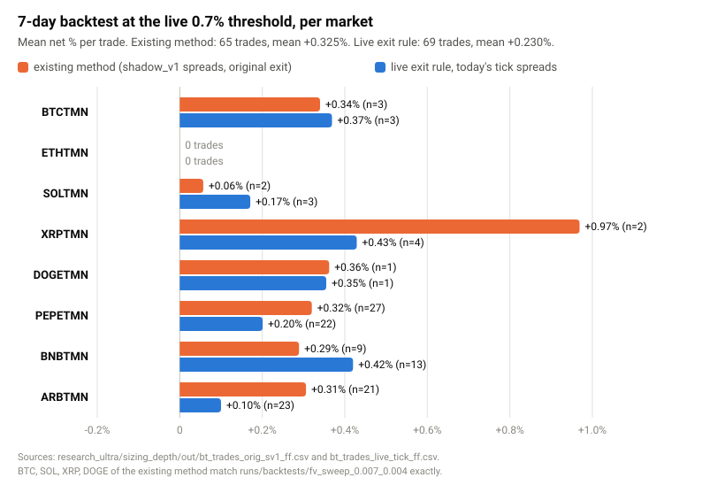
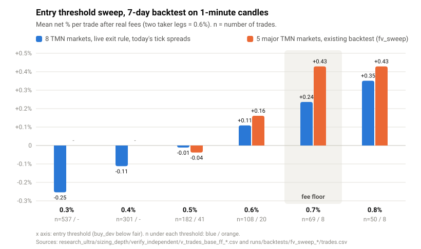
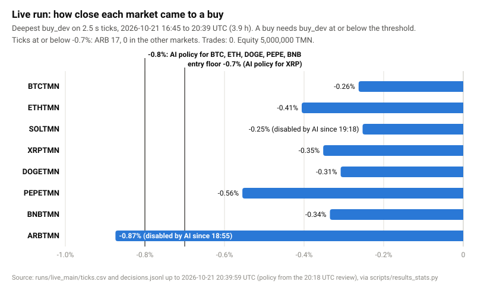

# نتایج: بک‌تست، تست سایه و اجرای زنده

این فایل فقط عدد واقعی دارد. کنار هر عدد، فایلی آمده که آن عدد از آن درآمده است.

- `MAIN` یعنی پوشهٔ ربات زنده (`wallex-bot`). `WT` یعنی همین ریپو.
- عددهای اجرای زنده یک برش ثابت‌اند: **2026-10-21 ساعت 21:20 UTC، یعنی تا ساعت 00:50 بامداد 30 مهر به وقت تهران** (حدود 47 ساعت مانده به پایان مسابقه). این برش بعد از دوازدهمین بازبینی هوش مصنوعی (21:19 UTC) است.
- جدول اصلی بک‌تست (۲.۱) از `runs/backtests/fv_live_rule_0.007/summary.json` است که `scripts/bt_fairvalue.py` ساخته است.
- بخش ۲.۶ (همان قانون روی 30 روز) از `runs/backtests/fv_live_rule_30d/`، `fv_ai_policy_30d/` و `fv_watch_30d/` است. عددهای تومانی از `toman.json` همان پوشه‌هاست که `scripts/bt_toman.py` ساخته، و مقایسه با دفتر سفارش زنده از `docs/bt30_live_overlap.json` که `scripts/bt_live_overlap.py` ساخته.
- عددهای بخش ۳ و ۴ و جدول‌های ۲.۳ و ۲.۴ را `scripts/results_stats.py` از فایل‌های ضبط‌شده می‌سازد. عددهای بخش ۴ این نسخه با `--cutoff 2026-10-21T21:20:00` ساخته شده‌اند و در `docs/results_stats_2120.json` هستند (بخش «بازتولید»). فایل `docs/results_stats.json` و نمودارهای `docs/img/` برش زودتری دارند (20:40 UTC) که روی خود نمودار نوشته شده است.
- نمودارها را `scripts/make_results_charts.py` می‌سازد (SVG ساده، بدون matplotlib).
- «درصد خالص» یعنی سود یا زیان هر معامله بعد از کارمزد واقعی. در بازارهای تومانی هر دو طرف معامله تیکر است: 0.3% + 0.3% = 0.6%.

---

## ۱. خلاصه

- قاعده ساده است: وقتی قیمت خرید والکس دست‌کم 0.7% ارزان‌تر از فاصلهٔ عادی‌اش با قیمت منصفانهٔ جهانی (بایننس × نرخ تتر به تومان) باشد می‌خریم و وقتی فاصله بسته شد می‌فروشیم. کف 0.7% از دو کارمزد تیکر (0.6%) به‌علاوهٔ 0.1% می‌آید.
- بک‌تست مرجع 7 روزه، با قانون خروج ربات زنده، پنجرهٔ ثابت و اسپردهای ثبت‌شده: 8 بازار تومانی با آستانهٔ 0.7%، **67 معامله، میانگین خالص +0.291%، جمع +19.51 واحد درصد، برد 71.6%**. ولی اگر خرید یک دقیقهٔ معامله‌دار دیرتر انجام شود، میانگین **-0.377%** می‌شود. پس این سود به سیگنال‌های تک‌دقیقه‌ای وابسته است (بخش ۲.۲).
- همین قانون روی 30 روز (31 شهریور تا 30 مهر): **361 معامله، میانگین خالص +0.136%**، و با خرید یک دقیقه دیرتر **-0.487%**. روی یک حساب 5,000,000 تومانی با قوانین `risk.py`: خرید همان لحظه **+360,109 تومان (+7.20%)**، خرید یک دقیقه دیرتر **-166,993 تومان** و کلید قطع 3% در روز چهارم. در 14 ساعتی که این پنجره با دفتر سفارش زنده هم‌پوشانی دارد، یکی از 3 سیگنال بک‌تست در دفتر واقعی نبود و دو تای دیگر در خود بک‌تست ضرر داده‌اند (بخش ۲.۶).
- تست سایه (1.8 ساعت): 1 معامله، ETHUSDT با +0.301%. اجرای زنده تا 00:50 بامداد 30 مهر به وقت تهران (4.6 ساعت تیک): **0 معامله**، سرمایه 5,000,000 تومان بی‌تغییر، افت 0%. هیچ بازار روشنی به آستانه‌اش نرسید. تنها عبور از -0.7% مال ARB بود (00:05 بامداد، حدود 40 ثانیه، تا -0.874%)، وقتی هوش مصنوعی آن را خاموش کرده بود. بازپخش همان لحظه با قانون موتور یک خروج زمانی با حدود -0.6% خالص می‌دهد (بخش ۴.۴).
- هوش مصنوعی در 12 بازبینی زنده 11 بار «دفاعی» و یک بار «عادی» (23:48 به وقت تهران) داد. ضریب اندازهٔ معامله همیشه بین 0.15 و 0.4 بود. از بازبینی 00:18 بامداد فقط 4 بازار روشن مانده‌اند: BTC، ETH، XRP و DOGE. این چهار در بک‌تست مرجع روی هم 6 معامله در 7 روز دارند، یعنی کمتر از یکی در روز (بخش ۴.۳).
- این جلسه 7 سنجش تازه با دادهٔ ضبط‌شده انجام شد: 5 ایدهٔ بهبود رد شد، سلامت ربات زنده پذیرفته شد، و بزرگ‌تر کردن معامله اثبات نشد و تصمیمش با دایی است.

---

## ۲. بک‌تست روی دادهٔ یک‌دقیقه‌ای (7 روز؛ 30 روز در ۲.۶)

**روش** (`scripts/bt_fairvalue.py --live-exit`؛ خروجی `runs/backtests/fv_live_rule_0.007/`):
- داده: کندل یک‌دقیقه‌ای والکس (`research/candles/`) و بستهٔ دقیقه‌ای بایننس. پنجرهٔ ثابت 2026-10-14 14:04 تا 10-21 14:04 UTC (7 روز). کندل ARB از 10-14 15:51 UTC شروع می‌شود.
- قیمت منصفانه = بستهٔ بایننس × بستهٔ USDTTMN والکس.
- خط پایه = میانهٔ متحرک 180 دقیقه‌ای پریمیوم. در دقیقهٔ i فقط دادهٔ قبل از i دیده می‌شود.
- فقط دقیقه‌هایی که والکس واقعا معامله داشته حساب شده‌اند.
- سابقهٔ دفتر سفارش نداریم. قیمت خرید = بسته × (1 + نصف اسپرد) و قیمت فروش = بسته × (1 - نصف اسپرد). اسپردها در `research/live_spreads_shadow_v1.json` ثبت شده‌اند: پنج بازار اصلی از `shadow_v1` (70 ثانیه، حدود 29 نمونه برای هر بازار) و PEPE، BNB و ARB از تیک‌های `live_main` پیش از 19:00 UTC (3,195 نمونه برای هر بازار؛ `samples` در همان فایل).
- قانون ربات زنده: ورود وقتی buy_dev ≤ -0.7%. خروج هدف وقتی sell_dev ≥ -0.05% **و** bid ≥ قیمت خرید × (1 + 2 × 0.3% + 0.05%). حد ضرر 0.9%. نگهداری حداکثر 25 دقیقه. فیلتر ریزش 60 ثانیه‌ای با بازده یک‌دقیقه‌ای بایننس تقریب زده شده (در این پنجره هیچ معامله‌ای را حذف نکرد).
- خالص = (1 - کارمزد تیکر)² × bid ÷ ask - 1.

### ۲.۱ نتیجهٔ مرجع: 8 بازار تومانی با آستانهٔ 0.7%

| بازار | تعداد / میانگین خالص / جمع / برد | خروج‌ها | اسپرد استفاده‌شده |
|---|---|---|---|
| BTCTMN | 3 / +0.339% / +1.02 / 100% | هدف 3 | 0.059% |
| ETHTMN | 0 | - | 0.185% |
| SOLTMN | 2 / +0.055% / +0.11 / 100% | هدف 1، زمان 1 | 0.268% |
| XRPTMN | 2 / +1.018% / +2.04 / 100% | هدف 2 | 0.327% |
| DOGETMN | 1 / +0.361% / +0.36 / 100% | هدف 1 | 0.162% |
| PEPETMN | 23 / +0.349% / +8.03 / 73.9% | هدف 15، زمان 8 | 0.089% |
| BNBTMN | 13 / +0.346% / +4.50 / 69.2% | هدف 8، زمان 5 | 0.131% |
| ARBTMN | 23 / +0.150% / +3.46 / 60.9% | هدف 12، زمان 10، ضرر 1 | 0.434% |
| **همه** | **67 / +0.291% / +19.51 / 71.6%** | هدف 42، زمان 24، ضرر 1 | |
| 4 روز اول (تا 10-18 14:04) | 28 / +0.311% / +8.72 | | |
| 3 روز آخر | 39 / +0.277% / +10.80 | | |

منبع: `runs/backtests/fv_live_rule_0.007/summary.json` و `trades.csv`. ردیف‌های 4 روز و 3 روز را از `trades.csv` حساب کرده‌ایم.

- «جمع» یعنی جمع درصد خالص معامله‌ها (واحد درصد)، نه بازده حساب.
- 88% معامله‌ها (59 از 67) در PEPE، BNB و ARB است. پنج بازار اصلی روی هم 8 معامله دارند.
- یک معاملهٔ PEPE در 10-20 ساعت 13:59 UTC (یک پامپ) به‌تنهایی +5.47 از جمع +19.51 است. بدون آن، 66 معامله با میانگین +0.213% می‌ماند. 5 معاملهٔ برتر 64% جمع را می‌سازند و بدون آن‌ها میانگین +0.114% است.
- تنها حد ضرر، ARB در 10-19 ساعت 22:01 UTC بود: -1.64%.
- PEPE، BNB و ARB روی همین 7 روز از میان 8 نامزد انتخاب شدند. پس این سه بازار درون‌نمونه‌اند.
- در کد این ریپو، هوش مصنوعی همین فایل را با ابزار `get_backtest` می‌خواند (`fairvalue.backtest_reference` در `config.json`)، همراه یادداشتی که هشدارهای بخش ۲.۲ را دارد. پروسهٔ زنده تا این برش هنوز فایل قبلی را می‌خواند (بخش ۴.۶).

### ۲.۲ لبهٔ سود چقدر شکننده است

سود بک‌تست بالا شکننده است. آن را سقف خوش‌بینانه بدانید، نه پیش‌بینی:
- **سیگنال‌ها کمتر از یک دقیقه می‌مانند.** کندل والکس فقط قیمت آخرین معامله است. بیشتر ورودهای بک‌تست یک چاپ تک‌دقیقه‌ای‌اند: در بازسازی 69 معامله‌ای، 54 سیگنال در دقیقهٔ معامله‌دار بعدی دیگر وجود نداشتند و فقط حدود 22% ماندند (`research_ultra/multi_ref_fair/verify_audit/a5_single_print.csv`).
- **ورود یک دقیقه دیرتر منفی است.** همین 67 معامله اگر در بستهٔ دقیقهٔ معامله‌دار بعدی خریده شوند، میانگین هر معامله -0.377% می‌شود (`trades_next_minute.csv` و `robustness` در `summary.json`). بازسازی قبلی با اسپردهای تیک امروز -0.513% داده بود (`research_ultra/multi_ref_fair/verify_audit/a3_summary_lag1_lag1_2m_persist.json`).
- **ربات زنده هنوز در بازار روشنی به آستانه نرسیده.** ربات هر 2.5 ثانیه دفتر سفارش واقعی را می‌خواند، پس فقط ask واقعی آن‌قدر ارزان حساب می‌شود و واقعیت جایی بین این دو عدد است. تا 00:50 بامداد 30 مهر، در 4.6 ساعت تیک زنده، فقط ARB یک بار حدود 40 ثانیه از -0.7% رد شد، آن هم وقتی خاموش بود (بخش ۴.۴). بازپخش همان لحظه با قانون موتور یک خروج زمانی با حدود -0.6% خالص می‌دهد. یک مورد چیزی را ثابت نمی‌کند، ولی با هشدار بالا هم‌جهت است و نشانهٔ مثبتی هم نیست.
- **نرخ تتر کهنه در شب.** 27 از 67 معامله وقتی بودند که آخرین معاملهٔ USDTTMN بیش از 5 دقیقه قبل بود (بیشتر شب‌ها، حدود 20:00 تا 05:30 UTC در این داده). میانگین آن‌ها +0.142% است و میانگین 40 معاملهٔ دیگر +0.392% (`stale_usdt_rate` در `summary.json`).

### ۲.۳ مقایسه با بازسازی‌های قبلی

پیش از ساختن فایل مرجع، دو بازسازی دیگر از همین قاعده داشتیم که جدول زیر نگهشان داشته است:
- **روش موجود**: قاعدهٔ خروج اولیه (هدف وقتی bid فقط از قیمت خرید بالاتر برود) و اسپردهای `shadow_v1`. برای BTC، SOL، XRP و DOGE همان معامله‌ها، با همان زمان و همان نوع خروج، در `runs/backtests/fv_sweep_0.007_0.004/trades.csv` هست و بازده هر معامله کمتر از 0.001 واحد درصد با آن فرق دارد (برای همین SOL اینجا +0.057% است و در `summary.json` همان پوشه +0.056%). منبع کل ستون: `research_ultra/sizing_depth/out/bt_trades_orig_sv1_ff.csv` (فایل `research_ultra/live_audit/bt_trades_bt_orig.csv` همین 65 معامله را مستقل بازتولید کرد).
- **قاعدهٔ زنده با اسپرد تیک**: همان قاعدهٔ خروج ربات زنده، ولی اسپرد از تیک‌های shadow_v2 تا v6 به‌علاوهٔ live_main تا 18:15 UTC، و نگهداری ARB حداکثر 15 دقیقه (تنظیم ARB در بازبینی‌های زندهٔ آن ساعت). منبع: `research_ultra/sizing_depth/out/bt_trades_live_tick_ff.csv`.
- هر دو روی 6.85 روز (از 10-14 17:41 UTC) اجرا شدند.

| بازار | روش موجود: تعداد / میانگین خالص / جمع | خروج‌ها | قاعدهٔ زنده با اسپرد تیک: تعداد / میانگین خالص / جمع | خروج‌ها |
|---|---|---|---|---|
| BTCTMN | 3 / +0.340% / +1.02 | هدف 3 | 3 / +0.369% / +1.11 | هدف 3 |
| ETHTMN | 0 | - | 0 | - |
| SOLTMN | 2 / +0.057% / +0.11 | هدف 2 | 3 / +0.171% / +0.51 | هدف 3 |
| XRPTMN | 2 / +0.969% / +1.94 | هدف 2 | 4 / +0.429% / +1.72 | هدف 4 |
| DOGETMN | 1 / +0.362% / +0.36 | هدف 1 | 1 / +0.355% / +0.35 | هدف 1 |
| PEPETMN | 27 / +0.320% / +8.63 | هدف 25، زمان 2 | 22 / +0.201% / +4.42 | هدف 14، زمان 8 |
| BNBTMN | 9 / +0.289% / +2.60 | هدف 7، زمان 2 | 13 / +0.420% / +5.46 | هدف 9، زمان 4 |
| ARBTMN | 21 / +0.306% / +6.43 | هدف 19، زمان 2 | 23 / +0.100% / +2.31 | هدف 9، زمان 14 |
| **همه** | **65 / +0.325% / +21.09، برد 69.2%** | هدف 59، زمان 6، ضرر 0 | **69 / +0.230% / +15.88، برد 71.0%** | هدف 43، زمان 26، ضرر 0 |
| روزهای 1 تا 4 | 28 / +0.313% | | 29 / +0.219% | |
| روزهای 5 تا 7 | 37 / +0.333% | | 40 / +0.238% | |



فرق فایل مرجع (67 / +0.291%) با ستون دوم (69 / +0.230%) از دو ورودی می‌آید:
1. **منبع اسپرد.** اسپرد `shadow_v1` برای SOL، XRP و BTC پهن‌تر از میانهٔ تیک‌های live_main است (SOL 0.268% در برابر 0.116%، XRP 0.327% در برابر 0.122%، BTC 0.059% در برابر 0.036%؛ هر دو عدد در `research/live_spreads_shadow_v1.json`). با اسپرد پهن‌تر، SOL از 3 به 2 معامله و XRP از 4 به 2 معامله می‌رسد. برای PEPE، BNB و ARB هم برش تیک‌ها فرق دارد (19:00 در برابر 18:15 UTC) و همین فرق کوچک اسپرد میانگین این بازارهای کم‌نمونه را جابه‌جا می‌کند.
2. **نگهداری ARB.** 25 دقیقه در فایل مرجع، 15 دقیقه در ستون دوم.

**اجرای اول PEPE، BNB و ARB با 0.6%** (`runs/backtests/fv_extra_tmn/summary.json`؛ اسپرد از عکس‌فوری بازار در همان لحظه):
PEPE: 50 معامله، +0.148% میانگین. BNB: 12 معامله، +0.213%. ARB: 30 معامله، +0.102% (یک حد ضرر).
این سه بازار از میان 8 نامزد همین فایل انتخاب شدند. STMN و PUMPTMN با میانگین نزدیک صفر کنار رفتند.

### ۲.۴ چرا کف 0.7% است: آزمون آستانه

| آستانه | 5 بازار اصلی، روش موجود: تعداد / میانگین / جمع | 8 بازار، قاعدهٔ زنده: تعداد / میانگین / جمع / برد |
|---|---|---|
| 0.3% | - | 537 / -0.254% / -136.30 / 36.1% (ضرر 15) |
| 0.4% | - | 301 / -0.112% / -33.64 / 48.5% (ضرر 8) |
| 0.5% | 41 / -0.038% / -1.54 | 182 / -0.011% / -2.00 / 55.5% (ضرر 3) |
| 0.6% | 20 / +0.161% / +3.22 | 108 / +0.109% / +11.77 / 62.0% (ضرر 1) |
| **0.7%** | **8 / +0.429% / +3.43** | **69 / +0.236% / +16.31 / 71.0%** |
| 0.8% | 8 / +0.429% / +3.43 | 50 / +0.351% / +17.56 / 76.0% |

منبع‌ها: ستون اول `runs/backtests/fv_sweep_0.005_0.003`، `fv_sweep_0.006_0.0035`، `fv_sweep_0.007_0.004` و `fv_sweep_0.008_0.005` (فایل `trades.csv`). ستون دوم بازسازی مستقل یکی از بازبین‌ها با اسپرد تیک: `research_ultra/sizing_depth/verify_independent/v_trades_base_ff_0.003.csv` تا `0.008.csv`. عدد 0.7% این ستون (+0.236%) با ستون دوم ۲.۳ (+0.230%) کمی فرق دارد، چون برش تیک‌ها برای اسپرد کمی متفاوت بوده است. فایل مرجع ۲.۱ در 0.7%: 67 / +0.291% / +19.51.



برداشت:
- زیر 0.6%، میانگین هر معامله صفر یا منفی است. یعنی فاصله‌ای که بسته می‌شود از دو کارمزد کمتر است. کف 0.7% این را در کد می‌بندد.
- 0.8% در کل هفته میانگین بالاتر و جمع کمی بیشتر دارد (+17.56 در برابر +16.31). در آزمون رو به جلو (انتخاب روی 4 روز اول، آزمون روی 3 روز آخر) روی 4 روز اول 0.8% بهتر بود (+7.47 در برابر +5.88)، ولی در 3 روز آخر 0.7% بهتر بود (+10.40 با 35 معامله در برابر +9.81 با 27 معامله). منبع: `research_ultra/dynamic_threshold/result.json`. پس این دو را نمی‌شود از هم جدا کرد. 0.7% کف ماند چون معاملهٔ بیشتری می‌دهد. هوش مصنوعی اجازه دارد آستانه را برای هر بازار بالاتر ببرد. در بازبینی 00:49 بامداد 30 مهر آن را برای هر چهار بازار روشن (BTC، ETH، XRP و DOGE) روی 0.8% گذاشت و SOL، PEPE، BNB و ARB خاموش بودند (`policies` همان بازبینی در `MAIN/runs/live_main/decisions.jsonl`).

### ۲.۵ استراتژی‌هایی که امتحان و رد شدند

| استراتژی | داده | معامله | نتیجه | منبع |
|---|---|---|---|---|
| سه استراتژی تکنیکال (پولبک در روند، برگشت از باند بولینگر، شکست با حجم)، هر سیگنال جدا | 60 روز کندل 15 دقیقه‌ای، 5 بازار تومانی | 452 | میانگین -0.641% در هر معامله، برد حدود 24% | خروجی کنسول `python scripts/edge.py` روی کندل‌های داخل ریپو. فایل خروجی ندارد؛ در این جلسه دوباره اجرا شد و همین عددها را داد. این عدد از `rules_summary.json` نیست |
| همان سه استراتژی با سبد، مدیریت ریسک و کمیتهٔ هوش مصنوعی | 2026-08-22 تا 10-21 (60 روز) | 18 | بازده -4.90%، بیشترین افت 5.21%، برد 22.2%، میانگین -0.795%، 12 خروج از 18 با حد ضرر | `runs/backtests/rules_summary.json` |
| سفارش خرید نشسته برای گرفتن دم‌های چندثانیه‌ای، 0.8% زیر فاصلهٔ عادی با قیمت منصفانه | 7 روز، 9 بازار | 173 | جمع -11.07، میانگین -0.064%، 22 حد ضرر | `runs/backtests/wick_summary.json` |
| همان، 1.0% زیر فاصلهٔ عادی | همان | 94 | جمع +7.15، ولی بدون ARB -1.21؛ 4 بازار از 9 منفی | همان |
| همان، 1.2% زیر فاصلهٔ عادی | همان | 52 | جمع +4.56، بدون ARB +3.12؛ 3 بازار از 9 منفی؛ نمونهٔ کوچک | همان |

جمع‌های ردیف «دم» را `scripts/results_stats.py` از `wick_summary.json` حساب کرده است. 47 بازار تومانی دیگر هم آزموده شدند (`runs/backtests/fv_all_tmn/summary.json`). بیشترشان کم‌معامله‌اند و «فرصت»هایشان قیمت کهنه است.

### ۲.۶ همین قانون روی 30 روز، و سود به تومان

**روش:** همان `scripts/bt_fairvalue.py --live-exit` با همان قانون و همان فایل اسپرد بخش ۲ (`research/live_spreads_shadow_v1.json`)، فقط با پنجرهٔ 30 روزه: 2026-09-22 07:00 تا 10-22 07:00 UTC، یعنی 31 شهریور ساعت 10:30 تا 30 مهر ساعت 10:30 به وقت تهران. خروجی `runs/backtests/fv_live_rule_30d/`.
- کندل‌ها در `research/candles_30d/` ثبت‌اند و با `research/fetch_candles.py --end` از API عمومی والکس گرفته شده‌اند. طبق `_manifest.json` همان پوشه، هر بازار 42,932 تا 43,104 دقیقه از 43,200 دقیقه را دارد. همهٔ بازارها یک حفرهٔ مشترک 81 تا 95 دقیقه‌ای در 09-22 ساعت 12:38 UTC دارند و USDTTMN یک حفرهٔ شبانهٔ 620 دقیقه‌ای از 10-19 ساعت 21:50 UTC.
- **همخوانی با فایل مرجع:** در پنجرهٔ 7 روزهٔ بخش ۲.۱ (10-14 14:04 تا 10-21 14:04 UTC)، این اجرا دقیقا همان 67 معامله را با همان بازار و همان دقیقه دارد، با همان میانگین +0.291% و جمع +19.51 (مقایسهٔ `trades.csv` دو پوشه). پس دادهٔ تازه و کد همان نتیجهٔ مرجع را می‌دهند.

| بازار | تعداد / میانگین خالص / جمع / برد | خروج‌ها | خرید یک دقیقه دیرتر: تعداد / میانگین | نرخ تتر کهنه: تعداد / میانگین |
|---|---|---|---|---|
| BTCTMN | 26 / +0.099% / +2.57 / 65.4% | هدف 12، زمان 11، ضرر 3 | 22 / -0.484% | 13 / -0.382% |
| ETHTMN | 15 / +0.545% / +8.18 / 86.7% | هدف 13، زمان 2 | 15 / -0.401% | 3 / +0.126% |
| SOLTMN | 9 / +0.738% / +6.64 / 77.8% | هدف 6، زمان 3 | 9 / -0.717% | 1 / -0.605% |
| XRPTMN | 15 / +0.129% / +1.93 / 46.7% | هدف 7، زمان 7، ضرر 1 | 16 / -0.353% | 2 / +0.512% |
| DOGETMN | 21 / +0.203% / +4.26 / 81.0% | هدف 16، زمان 5 | 19 / -0.653% | 7 / -0.362% |
| PEPETMN | 155 / +0.079% / +12.22 / 60.6% | هدف 83، زمان 64، ضرر 8 | 150 / -0.308% | 30 / +0.017% |
| BNBTMN | 17 / +0.363% / +6.17 / 64.7% | هدف 10، زمان 7 | 17 / -0.245% | 10 / +0.288% |
| ARBTMN | 103 / +0.067% / +6.93 / 54.4% | هدف 43، زمان 51، ضرر 9 | 105 / -0.765% | 31 / +0.200% |
| **همه** | **361 / +0.136% / +48.92 / 61.5%** | هدف 190، زمان 150، ضرر 21 | **353 / -0.487%** | 97 / +0.030% (بقیه +0.174%) |

منبع: `runs/backtests/fv_live_rule_30d/summary.json`.

- میانگین هر معامله در 30 روز (+0.136%) کمتر از نصف پنجرهٔ 7 روزهٔ مرجع (+0.291%) است.
- 5 معاملهٔ برتر 25.40 از جمع 48.92 را می‌سازند (52%) و بدون آن‌ها میانگین +0.066% است. بزرگ‌ترینشان ARB در 10-07 ساعت 02:04 UTC با +6.63% است (`trades.csv`).
- PEPE و ARB با هم 258 از 361 معامله‌اند (71%).
- 21 حد ضرر خورد و ضرر خالص هر کدام بین -1.49% و -4.15% بود، چون قیمت کندل یک‌دقیقه‌ای از حد ضرر 0.9% رد می‌پرد.

**هفته به هفته** (هفته‌ها از اولین روز پنجره به وقت تهران شمرده شده‌اند؛ `trades.csv` و `trades_next_minute.csv`):

| هفته (تهران) | خرید همان لحظه: تعداد / میانگین / جمع | خرید یک دقیقه دیرتر: تعداد / میانگین |
|---|---|---|
| 31 شهریور تا 6 مهر | 97 / +0.039% / +3.79 | 101 / -0.590% |
| 7 تا 13 مهر | 72 / -0.047% / -3.37 | 71 / -0.677% |
| 14 تا 20 مهر | 92 / +0.237% / +21.82 | 82 / -0.216% |
| 21 تا 27 مهر | 73 / +0.254% / +18.51 | 71 / -0.485% |
| 28 تا 30 مهر (2.4 روز) | 27 / +0.302% / +8.17 | 28 / -0.427% |

دو هفتهٔ اول حتی با خرید همان لحظه نزدیک صفرند. پنجرهٔ مرجع بخش ۲.۱ (22 تا 29 مهر) در نیمهٔ خوب این ماه افتاده است. با خرید یک دقیقه دیرتر هر پنج هفته منفی‌اند.

**به تومان** (`scripts/bt_toman.py`؛ خروجی `toman.json` کنار همان نتیجه): معامله‌ها به ترتیب زمان روی یک حساب 5,000,000 تومانی با خود `wallexbot/risk.py` و بخش `risk` در `config.json` بازپخش می‌شوند. اندازهٔ هر سفارش را `RiskManager.size` تعیین می‌کند، و حداکثر 3 موقعیت، استراحت 120 دقیقه‌ای بعد از ضرر، سقف ضرر روزانهٔ 1.5%، کلید قطع 3% و قفل سود همان قوانین زنده‌اند. ضریب اندازهٔ هوش مصنوعی یک بار 0.5 (سیاست پیش‌فرض) و یک بار 0.3 (نزدیک ضریب بازبینی‌های زنده) گرفته شده است.

| حالت | ضریب 0.5 | ضریب 0.3 |
|---|---|---|
| خرید همان لحظه | **+360,109 تومان (+7.20%)**، 276 معامله، میانگین سفارش 768,964 تومان، بیشترین افت 2.34% | +229,629 تومان (+4.59%)، 276 معامله، بیشترین افت 1.62% |
| خرید یک دقیقه دیرتر | **-166,993 تومان (-3.34%)**، 33 معامله؛ کلید قطع در 09-25 ساعت 23:56 UTC (4 مهر ساعت 03:26 به وقت تهران) | -152,721 تومان (-3.05%)، 45 معامله؛ کلید قطع در 09-27 ساعت 13:05 UTC |
| خرید یک دقیقه دیرتر، بدون کلید قطع | -1,077,989 تومان (-21.56%)، 231 معامله | -705,763 تومان (-14.12%)، 240 معامله |

منبع: `runs/backtests/fv_live_rule_30d/toman.json`.

- در حالت خرید همان لحظه با ضریب 0.5، 85 معامله از 361 انجام نشد: 79 به‌خاطر استراحت بعد از ضرر و 6 به‌خاطر سقف 3 موقعیت. 19 روز با سود و 11 روز با ضرر بسته شد. بهترین روز +146,877 و بدترین -61,318 تومان بود.
- سهم بازارها در همان حالت (تومان): PEPE +90,730، SOL +67,532، BTC +47,640، DOGE +47,628، ETH +40,886، BNB +38,908، ARB +30,709، XRP -3,924. هفته به هفته: +66,662، +25,678، +106,186، +104,487، +57,096.
- برای مقایسه، همین اسکریپت روی خروجی دستور بازتولید بخش ۲.۱ (پنجرهٔ 7 روزهٔ مرجع) با ضریب 0.5، +206,253 تومان (+4.13%) با خرید همان لحظه و -150,210 تومان با خرید یک دقیقه دیرتر می‌دهد (`python scripts/bt_toman.py runs/backtests/rerun_live_rule`). یعنی تنها هفتهٔ مرجع بیشتر از نصف سود کل این ماه را نشان می‌داد.
- ساده‌سازی‌ها، که در `note` همان فایل هم آمده: ارزش حساب فقط موقع بسته شدن معامله عوض می‌شود (موتور زنده موقعیت باز را هر تیک ارزش‌گذاری می‌کند، پس کلید قطعش ممکن است زودتر بزند)، هر سفارش کامل پر می‌شود چون سابقهٔ دفتر سفارش نداریم، و مرحله‌های پایان مسابقه خاموش‌اند.

**تنظیم فعلی هوش مصنوعی** (`runs/backtests/fv_ai_policy_30d/`): آستانهٔ 0.8% برای هر 8 بازار، حد ضرر 0.8% و نگه‌داری حداکثر 20 دقیقه. این نزدیک سیاست بازبینی 07:19 UTC روز 22 اکتبر است که BNB را روی 1.1% و ARB را روی 0.9% گذاشته بود (`MAIN/runs/live_main/decisions.jsonl`). نتیجه: 262 معامله، میانگین +0.205%، جمع +53.83، و با خرید یک دقیقه دیرتر -0.480% (256 معامله). به تومان با ضریب 0.5: +334,463 تومان (+6.69%) با خرید همان لحظه، و -155,364 تومان با خرید یک دقیقه دیرتر و کلید قطع در 09-27 ساعت 16:44 UTC (`toman.json` همان پوشه). یعنی معاملهٔ کمتر با نتیجهٔ تقریبا یکسان.

**بازارهای تماشایی POL و SAND** (`runs/backtests/fv_watch_30d/`): اسپرد میانهٔ زندهٔ این دو بازار از تیک‌های `live_main` (از اولین تیکشان در 06:12 تا 08:00 UTC روز 22 اکتبر، 2,464 نمونه برای هر بازار) برای POL 2.20% و برای SAND 0.61% است (`research/live_spreads_watch.json`). هر دو بالای سقف اسپرد 0.6% موتورند، پس بک‌تست 30 روزه با این اسپردها **هیچ ورودی** نمی‌دهد. اسپرد POL فقط در 1.5% تیک‌ها و اسپرد SAND در 48.1% تیک‌ها زیر سقف بود. عددهای مثبت بک‌تست 7 روزهٔ این دو بازار در README (کامیت `50d49d1`) با اسپرد باریک‌تری از یک عکس فوری دفتر سفارش، پیش از ضبط زنده، حساب شده بودند و اسپرد زنده آن‌ها را تأیید نمی‌کند. دروازهٔ کد در `supervisor.py` هم همین را می‌بیند، چون بازپخشش روی تیک‌های زنده با اسپرد واقعی است.

**مقایسه با دفتر سفارش زنده** (`docs/bt30_live_overlap.json`): ضبط زندهٔ دفتر سفارش از 10-21 ساعت 16:45 UTC شروع شد، پس 14.25 ساعت آخر این پنجره را دفتر واقعی هم دیده است. بک‌تست در این ساعت‌ها 3 ورود دارد:
- **PEPE، 10-21 ساعت 17:18 UTC** (+0.205% در بک‌تست): در دفتر زنده عمیق‌ترین buy_dev فقط -0.307% بود و میانهٔ اسپرد 0.743%. هیچ تیکی قانون ورود را برآورده نکرد، پس این سیگنال فقط در کندل وجود داشت. PEPE آن لحظه با سیاست هوش مصنوعی خاموش هم بود.
- **BNB، 10-22 ساعت 04:02 UTC** (-0.256% در بک‌تست، خروج زمانی): دفتر زنده تا -0.902% رفت و یک تیک قانون ورود را برآورده کرد، با میانهٔ اسپرد 0.760%. BNB خاموش بود.
- **BNB، 10-22 ساعت 04:50 UTC** (-0.561% در بک‌تست، خروج زمانی): تا -0.901%، یک تیک، میانهٔ اسپرد 0.260%. BNB خاموش بود.

پس از 3 ورود بک‌تست، یکی در دفتر سفارش واقعی وجود نداشت و دو تای واقعی در خود بک‌تست ضرر داده‌اند. نمونه کوچک است، ولی با هشدار بخش ۲.۲ هم‌جهت است.

**برداشت:**
- روی 30 روز، قانون فعلی فقط وقتی سود می‌دهد که خرید در همان دقیقهٔ سیگنال پر شود: +0.136% در هر معامله، که نیمی از جمعش از 5 معامله است. با یک دقیقه تأخیر هر پنج هفته منفی‌اند.
- سقف خوش‌بینانه برای یک ماه با 5 میلیون تومان حدود +360 هزار تومان است. کف را کلید قطع 3% تعیین می‌کند: در هر دو ضریب و هر دو تنظیم، حالت دیرتر حدود 150 تا 170 هزار تومان ضرر داد و ربات را متوقف کرد. بدون کلید قطع همین حالت با قانون پیش‌فرض 0.7 تا 1.1 میلیون تومان ضرر می‌داد.
- این بک‌تست منطق ربات زنده را عوض نمی‌کند. فایل مرجعی که هوش مصنوعی با `get_backtest` می‌خواند همان `fv_live_rule_0.007` است.

---

## ۳. تست‌های سایه

حالت سایه همان موتور زنده روی بازار واقعی است، با سفارش شبیه‌سازی‌شده: خرید به ask، فروش به bid، حجم محدود به ردیف اول دفتر، کارمزد واقعی. حساب کاغذی 2,000,000 تومان و 7.5 تتر بود (`config.json`، بخش `shadow`).

| اجرا | بازهٔ تیک (UTC، 2026-10-21) | مدت | بازارها | بازبینی هوش مصنوعی | معامله | نتیجه |
|---|---|---|---|---|---|---|
| shadow_v1 | 14:18:18 تا 14:19:28 | 1.2 دقیقه | 10 (5 تومانی + 5 تتری) | 0 | 0 | اجرای آزمایشی. اسپرد پنج بازار اصلی در بک‌تست‌ها از همین 290 تیک آمده است. |
| shadow_v2 | 14:19:52 تا 15:01:04 | 41.2 دقیقه | 10 | 3 (2 دفاعی، 1 توقف) | 0 | بدون معامله |
| shadow_v3 | 15:01:10 تا 15:26:03 | 24.9 دقیقه | 10 | 2 (دفاعی) | 1 | ETHUSDT: خرید وقتی buy_dev برابر -0.497% بود، یعنی 0.497% ارزان‌تر از فاصلهٔ عادی‌اش با قیمت منصفانه (آستانهٔ پیش‌فرض 0.35% پیش از اولین بازبینی). خروج هدف بعد از 625 ثانیه، **+0.301% خالص، +2,645 تومان** |
| shadow_v4 | 15:26:09 تا 15:44:35 | 18.4 دقیقه | 10 | 2 (دفاعی) | 0 | بدون معامله |
| shadow_v5 | 15:44:42 تا 15:55:15 | 10.5 دقیقه | 10 | 1 (دفاعی، 21 فراخوانی ابزار MCP) | 0 | بدون معامله |
| shadow_v6 | 15:55:23 تا 16:05:01 | 9.6 دقیقه | 13 (+PEPE، BNB، ARB) | 1 (دفاعی، 18 فراخوانی ابزار MCP) | 0 | بدون معامله |

منبع: `MAIN/runs/shadow_v*/ticks.csv`، `decisions.jsonl` و `state.json`، خوانده‌شده با `scripts/results_stats.py`.

- مجموع shadow_v2 تا v6: 104.6 دقیقه. کل سایه با shadow_v1: حدود 106 دقیقه، یعنی 1.8 ساعت. کل سایه: 1 معامله با سود.
- عمیق‌ترین فاصله در بازارهای تومانی سایه: ETHTMN با -0.488% (shadow_v3). هیچ بازار تومانی به -0.7% نرسید.
- تغییر ارزش حساب کاغذی در سایه (مثلا -0.216% در v3 با وجود یک معاملهٔ سودده) بیشتر از ارزش‌گذاری 7.5 تتر با نرخ لحظه‌ای تتر به تومان می‌آید، نه از معامله. برای همین آن را نتیجهٔ معاملاتی حساب نکرده‌ایم.
- سایه کوتاه بود و یک معامله دارد. فقط نشان می‌دهد زنجیرهٔ ورود، خروج، کارمزد و لاگ کار می‌کند. چیزی دربارهٔ سودآوری ثابت نمی‌کند.

**تست سایهٔ کد شاخهٔ ultra (shadow_ultra):** 21:45:57 تا 22:20:59 UTC، 35 دقیقه، 13 بازار، بدون هوش مصنوعی (`--no-ai`، پس سیاست پیش‌فرض با آستانهٔ 0.7%). شروع گرم از تیک‌های زنده با فیلتر تازه (فقط پوشه‌های `live_` و `shadow_`) درست کار کرد: 34,488 تیک خوانده شد و خط پایهٔ هر بازار از همان دقیقهٔ اول آماده بود. 10,920 تیک ثبت شد، هیچ خطایی در لاگ نیامد و موتور سر وقت متوقف شد. معامله‌ای نشد، چون عمیق‌ترین فاصله PEPETMN با -0.311% بود. منبع: `runs/shadow_ultra/decisions.jsonl` و `state.json`.

---

## ۴. اجرای زنده تا ساعت 00:50 بامداد 30 مهر به وقت تهران

برش: **2026-10-21 21:20 UTC**. منبع: `MAIN/runs/live_main/decisions.jsonl`، `state.json` و `ticks.csv` (فقط خواندن)، و `git log` همان پوشه.

### ۴.۱ تاریخچهٔ کد زنده

کامیتی که هر راه‌اندازی اجرا کرد از مقایسهٔ زمان رویداد `start` با زمان کامیت‌ها در `git log` برداشت شده است (برداشت از زمان‌ها، نه از خود پروسه). برای اولین راه‌اندازی، خود رویداد `start` نشان می‌دهد که کد هنوز کامیت نشده بود.

| شروع (UTC) | شروع (تهران) | کامیت (برداشت از زمان‌ها) | چه چیزی فرق داشت |
|---|---|---|---|
| 16:45:30 | 20:15:30 | درخت کاری بین `57e891e` (15:45 UTC) و `1dfdb1b` (16:50 UTC). رویداد `start` همین حالا 8 بازار تومانی را دارد که `1dfdb1b` کامیت کرد، در حالی که `config.json` در `57e891e` فقط 5 بازار تومانی و 5 تتری داشت | آستانهٔ پیش‌فرض 0.6%. کف آستانه در ناظر «یک کارمزد میکر + یک تیکر + 0.05%» یعنی 0.6% بود و موتور کفی نداشت. مدل مستقیم از OpenAI، فقط با MCP موتور، بازبینی هر 20 دقیقه |
| 16:52:50 | 20:22:50 | `1dfdb1b` (16:50 UTC) | MCP رسمی والکس با فهرست مجاز فقط‌خواندنی اضافه شد. کف هنوز 0.6% |
| 17:51:56 | 21:21:56 | `3ff1ca3` (17:50 UTC؛ کامیت بعدی، `7229c75`، 17:52 UTC) | کف ناظر دو کارمزد تیکر + 0.1% شد، یعنی 0.7%. مدل روی BoxAPI با OpenAI پشتیبان، بازبینی هر 30 دقیقه. آستانهٔ پیش‌فرض هنوز 0.6% و موتور هنوز بدون کف |
| 19:14:57 | 22:44:57 | `e15269e` (19:01 UTC) | کف 0.7% لحظهٔ خرید در خود موتور هم اعمال می‌شود و پیش‌فرض 0.7% است (`7229c75`). حلقهٔ ابزارمحور هم پشتیبان OpenAI دارد (`53c7a4c`). مدل gpt-5.6-sol |

- کامیت `0ee44ef` (20:25 UTC، یعنی 23:55 به وقت تهران) مدل را به gpt-6-sol از راه BoxAPI برد، با همان مدل روی OpenAI به‌عنوان پشتیبان برای هر دو مسیر. این مدل از راه‌اندازی بعدی بارگذاری می‌شود.
- شواهد هم‌خوان با این برداشت: اولین بازبینی (16:48) هیچ ابزار MCP رسمی صدا نزد، بازبینی‌های 16:56 تا 17:36 هر 20 دقیقه بودند و از 17:55 هر 30 دقیقه، و رویداد `start` در 19:14:57 اولین بار آستانهٔ پیش‌فرض 0.7% را نشان می‌دهد.
- **کف کارمزد:** قبل از 17:51:56 UTC کف 0.7% هنوز در کد نبود. بازبینی 16:48 UTC آستانهٔ همهٔ بازارهای روشن را 0.6% گذاشت و بازبینی 17:36 UTC آستانهٔ BTC را. در سه راه‌اندازی اول سیاست پیش‌فرض هم تا اولین بازبینی 0.6% بود. ولی پیش از راه‌اندازی 19:14:57 UTC هیچ تیکی در هیچ بازاری به -0.6% هم نرسید (عمیق‌ترین در کل آن بازه: ARB با -0.591%؛ عمیق‌ترین در بازه‌هایی که آستانه واقعاً 0.6% بود: PEPE -0.262%، DOGE -0.308%، و BTC -0.096%). پس هیچ معامله‌ای از این فاصله اثر نگرفت.

### ۴.۲ عددها

| مورد | مقدار |
|---|---|
| شروع | 2026-10-21 16:45:30 UTC (سه راه‌اندازی دوباره: 16:52:50، 17:51:56 و 19:14:57) |
| مدت | بازهٔ 274.5 دقیقه از اولین تا آخرین تیک، 6,550 تیک برای هر بازار، حدود هر 2.5 ثانیه |
| بازارها | BTC، ETH، SOL، XRP، DOGE، PEPE، BNB، ARB (همه تومانی) |
| معامله | **0** |
| سرمایه | 5,000,000 تومان، اول و آخر |
| بازده | 0.000% |
| بیشترین افت | 0.000% |
| توقف یا موقعیت باز | ندارد |
| بازبینی‌های هوش مصنوعی | 12: یازده «دفاعی» و یک «عادی» (20:18 UTC) |
| فراخوانی ابزار MCP | 246: سرور موتور 178، سرور رسمی والکس 68 (13 تا 29 در هر بازبینی) |
| بازارهای روشن در برش | 4: BTC، ETH، XRP و DOGE، همه با آستانهٔ 0.8% (بازبینی 21:19 UTC) |

هر بازبینی (اندازه و آستانه فقط برای بازارهای روشن):

| زمان UTC (تهران) | مدل در لاگ | حالت | ابزار: موتور / والکس رسمی | خاموش | اندازه | آستانه |
|---|---|---|---|---|---|---|
| 16:48:54 (20:18) | gpt-5.4-mini | دفاعی | 28 / 0 | XRP، BNB | 0.4 | 0.6% |
| 16:56:17 (20:26) | gpt-5.4-mini via MCP[engine, wallex-official] | دفاعی | 12 / 4 | ETH، PEPE، ARB | 0.4 | 0.7% |
| 17:16:14 (20:46) | همان | دفاعی | 12 / 4 | ETH، PEPE، ARB | 0.3 تا 0.4 | 0.7% |
| 17:36:17 (21:06) | همان | دفاعی | 9 / 4 | ETH، PEPE، ARB | 0.25 تا 0.4 | 0.7%، BTC 0.6% |
| 17:55:47 (21:25) | openai/gpt-5.4-mini via MCP[engine, wallex-official] | دفاعی | 16 / 6 | BNB | 0.4 | 0.7% |
| 18:25:41 (21:55) | همان | دفاعی | 18 / 8 | BNB | 0.3 | 0.7% تا 0.8% |
| 18:55:33 (22:25) | همان | دفاعی | 11 / 6 | BNB، ARB | 0.15 تا 0.2 | 0.7% تا 0.9% |
| 19:18:38 (22:48) | openai/gpt-5.6-sol via MCP[engine, wallex-official] | دفاعی | 13 / 8 | SOL، ARB | 0.25 تا 0.4 | 0.7% تا 0.8% |
| 19:48:42 (23:18) | همان | دفاعی | 13 / 8 | SOL، ARB | 0.2 تا 0.4 | 0.7% تا 0.8% |
| 20:18:35 (23:48) | همان | عادی | 13 / 8 | SOL، ARB | 0.2 تا 0.4 | 0.7% تا 0.8% |
| 20:48:32 (00:18) | همان | دفاعی | 12 / 4 | SOL، PEPE، BNB، ARB | 0.2 تا 0.4 | 0.7% تا 0.8% |
| 21:19:06 (00:49) | gpt-5.6-sol via MCP[engine, wallex-official] | دفاعی | 21 / 8 | SOL، PEPE، BNB، ARB | 0.2 تا 0.4 | 0.8% |

ستون «مدل در لاگ» تاریخچه است: مدلی که هر بازبینی در `analyst_model` ثبت کرد. مدل تنظیم‌شده در `config.json` حالا gpt-6-sol است (بخش ۴.۱). برچسب بازبینی 21:19 پیشوند `openai/` ندارد. یعنی حلقهٔ ابزارمحور روی BoxAPI خطا داد و همان ایجنت با همان مدل روی پشتیبان OpenAI اجرا شد (`analyst_with_tools` در `agent.py` برچسب مدلی را می‌نویسد که جواب داده است). پس پشتیبان OpenAI در اجرای زنده هم کار کرد.

### ۴.۳ هوش مصنوعی در اجرای زنده چه کرد

- **حالت:** 11 بازبینی از 12 «دفاعی» دادند. بازبینی 20:18 UTC (23:48 به وقت تهران) تنها «عادی» بود و دو بازبینی بعدی دوباره «دفاعی» شدند. چند بار تحلیلگر ریسک را عادی دانست ولی نتیجهٔ نهایی بعد از افسر ریسک «دفاعی» شد: در 16:48، 18:25 و 19:18 UTC، و در هر دو بازبینی آخر (20:48 و 21:19 UTC) (`analyst_summary` در برابر `risk_mode`).
- **اندازه:** هیچ‌وقت بالای 0.4 نرفت. پایین‌ترین در بازبینی 18:55 UTC بود: 0.2 برای پنج بازار و 0.15 برای PEPE. حتی در بازبینی «عادی» 20:18 اندازه بین 0.2 و 0.4 ماند. در برش، اندازهٔ چهار بازار روشن BTC 0.4، XRP 0.4، ETH 0.25 و DOGE 0.2 است.
- **بازارهای خاموش و دلیلی که خودش نوشت** (`reason` در `policies`):
  - BNB (17:55 تا 18:55): «اسپرد پهن و عمق پایین است، پس برای حفظ سرمایه غیرفعال شد».
  - ARB (از 18:55): «اسپرد بسیار پهن است و اجرای امن را سخت می‌کند»، و در 19:18: «اسپرد نزدیک یک درصد یک مشکل ساختاری و مانع اجرای کم‌ریسک است».
  - SOL (از 19:18): «عمق بسیار کم دفتر سفارش یک مشکل ساختاری برای اجرای امن است».
  - PEPE و BNB (از 20:48): برای PEPE «اسپرد نزدیک نیم‌درصد بدون پشتوانه بک‌تست، مشکل ساختاری اجراست» و برای BNB «عمق بسیار کم همراه با اسپرد نزدیک نیم‌درصد اجرای کم‌ریسک را ناممکن می‌کند». تحلیلگر در همان بازبینی نوشته بود همه بازارها روشن بمانند؛ این دو را افسر ریسک خاموش کرد. افسر اسپرد و عمق لحظهٔ بازبینی را از موتور می‌گیرد. در تیک‌های نیم ساعت پیش از آن، صدک 90 اسپرد PEPE 0.31% و BNB 0.54% بود (`research_ultra/review_docs/spreads_before_reviews.py`).
  - اولین بازبینی (16:48) XRP و BNB را خاموش کرد: «اسپرد این بازار بالاست و ریسک لغزش را زیاد می‌کند». بازبینی‌های 16:56 تا 17:36 ETH، PEPE و ARB را به دلیل اسپرد خاموش کردند، مثلا PEPE: «اسپرد بسیار پهن است و اجرای مطمئن ندارد».
- **PEPE و BNB کوچک ماندند چون بک‌تست نداشتند.** در 19:18 برای PEPE نوشت: «نبود بک‌تست و نوسان دنباله‌ای، توقف و زمان نگهداری کوتاه‌تر می‌طلبد» و برای BNB: «دفتر عمیق است، ولی نبود شواهد بک‌تست اندازه محافظه‌کارانه را ایجاب می‌کند». این حرف دربارهٔ شواهدی که به او رسیده بود درست بود: ابزار `get_backtest` در ربات زنده فایل `fv_sweep_0.006_0.0035` را می‌داد که فقط BTC، ETH، SOL، XRP، DOGE و بازارهای تتری را دارد.
- **برداشت ما:** میانهٔ اسپرد ARB در تیک‌های زنده تا این برش 0.409% بود و موتور خودش هر تیک با اسپرد بالای 0.6% را رد می‌کند. «نزدیک یک درصد» لحظه‌های بد را نشان می‌دهد: در بازرسی `live_audit` (تا 18:27 UTC) صدک 99 اسپرد ARB 1.056% بود و 23% تیک‌هایش اسپرد بالای 0.6% داشتند. خاموش کردن ARB محتاطانه است، ولی موتور بدون آن هم در این لحظه‌ها نمی‌خرید.
- تحلیلگر در 19:18 نوشت آستانه‌ها را بالای «0.55% TMN round-trip fee» نگه داشته است. این عدد قدیمی (یک کارمزد میکر + یک تیکر) از چند جای کد زنده می‌آمد: ابزار `list_markets`، پرامپت ایجنت (`AGENT_SYSTEM` در `agent.py`)، پرامپت `supervisor.py` و توضیحات سرور MCP موتور (`mcp_server.py`). فقط آمار موتور که به افسر ریسک می‌رسید 0.6% می‌گفت. در این ریپو همهٔ این‌ها حالا 0.6% (دو تیکر) می‌گویند (بخش ۴.۶). کف موتور این اشتباه را بی‌اثر کرده بود.

### ۴.۴ چرا معامله نشد

هیچ بازاری که همان لحظه روشن بود به آستانه‌اش نرسید. تنها تیک‌های زیر -0.7% مال ARB است، وقتی خاموش بود.

| بازار | عمیق‌ترین buy_dev | زمان (UTC) | تیک‌های زیر -0.7% | تیک‌های زیر -0.5% | میانهٔ اسپرد |
|---|---|---|---|---|---|
| BTCTMN | -0.263% | 19:25:04 | 0 | 0 | 0.038% |
| ETHTMN | -0.406% | 17:37:26 | 0 | 0 | 0.108% |
| SOLTMN | -0.253% | 19:24:24 | 0 | 0 | 0.181% |
| XRPTMN | -0.352% | 18:05:17 | 0 | 0 | 0.111% |
| DOGETMN | -0.308% | 17:54:21 | 0 | 0 | 0.127% |
| PEPETMN | -0.555% | 19:03:42 | 0 | 20 | 0.121% |
| BNBTMN | -0.335% | 18:07:30 | 0 | 0 | 0.101% |
| ARBTMN | -0.874% | 20:35:29 | 17 | 51 | 0.409% |

منبع: `docs/results_stats_2120.json` (`by_symbol`). عمیق‌ترین فاصله‌ها را با سیاست همان لحظه هم سنجیدیم (`research_ultra/review_docs/min_dev_enabled.py`):
- در بازاری که همان لحظه روشن بود، عمیق‌ترین فاصله ARB با -0.587% در 18:24:56 UTC بود (آستانه‌اش آن موقع 0.7%)، و بعد PEPE با -0.555% در 19:03:42 UTC (آستانه 0.9%).
- عمیق‌ترین فاصلهٔ ETH (-0.406%) در 17:37 UTC بود، وقتی ETH خودش خاموش بود (16:56 تا 17:55 UTC). داشبورد ETH را «نزدیک‌ترین بازار فعال» نشان می‌دهد، چون فقط بازارهای روشن در سیاست فعلی را رتبه می‌دهد، ولی روی همهٔ مدت اجرا.

**عبور ARB در 20:35 UTC (00:05 بامداد به وقت تهران).** 17 تیک پشت سر هم از 20:35:22 تا 20:36:02 UTC، حدود 40 ثانیه، زیر -0.7% بود و عمیق‌ترینش -0.874%. هوش مصنوعی ARB را از بازبینی 18:55 UTC خاموش کرده بود، پس ربات نخرید.
- دلیلی که هوش مصنوعی نوشته بود (اسپرد پهن و عمق کم) در آن لحظه برقرار نبود: اسپرد 0.002% بود و حدود 79 میلیون تومان روی اولین ردیف فروش بود (`research_ultra/review_docs/spreads_before_reviews.py`).
- ولی خرید هم سودی نمی‌داد. بازپخش همان تیک‌ها با `simulate_threshold` همین ریپو، که قانون خرید و فروش موتور را اجرا می‌کند، با سیاست ARB در آن ساعت (آستانه 0.8%، حد ضرر 0.8%، نگه‌داری 15 دقیقه) یک معامله می‌دهد: خروج زمانی بعد از 15 دقیقه با -0.601% خالص (`research_ultra/review_docs/arb_replay.py`). این بازپخش خروج زمانی را روی خود bid حساب می‌کند. موتور واقعی 0.3% زیر bid می‌فروشد، پس ضرر واقعی کمی بیشتر می‌شد.
- ابزار نسخهٔ قبلی که ربات زنده تا این برش داشت، همین لحظه را در بازبینی‌های 20:48 و 21:19 UTC یک خروج «هدف» با -0.027% نشان داد، چون قانون هدف قدیمی فقط می‌خواست bid از قیمت خرید بالاتر برود (بخش ۴.۶).



این نمودار برش 20:40 UTC را نشان می‌دهد، با سیاست بازبینی 20:18 UTC. پس PEPE و BNB در آن هنوز روشن‌اند؛ هر دو از بازبینی 20:48 UTC خاموش شدند. عمیق‌ترین فاصلهٔ هیچ بازاری بین 20:40 و این برش عوض نشد.

### ۴.۵ بازرسی ربات زنده

`research_ultra/live_audit/result.json`، برش 18:27 UTC، تایید هر دو بازبین:
- هیچ گیت دیگری جلوی خرید را نگرفته است. لاگ تا برش 21:20 UTC هم هیچ رویداد خطا، `skip` یا `blocked` ندارد.
- در بک‌تست هم 64% پنجره‌های 1.7 ساعته و 38% پنجره‌های 3.8 ساعته بدون ورود بودند. پس این سکوت هنوز عادی است. بازرس نوشت اگر تا حدود 2026-10-22 ساعت 18:00 UTC هنوز معامله‌ای نباشد، نشانهٔ خطر است.
- بازرس نشان داد پروسهٔ آن موقع از کد قبل از کامیت `7229c75` بالا آمده بود (خط شروع: `entry_dev` برابر 0.006). راه‌اندازی 19:14:57 UTC این را بست (بخش ۴.۱).
- مسیر واقعی سفارش هنوز روی صرافی اجرا نشده است. خواندن موجودی و سفارش‌های باز هر دقیقه کار می‌کند. اولین خرید، اولین آزمون واقعی سفارش است.

### ۴.۶ اصلاح شواهد ابزارهای هوش مصنوعی

بازرسی چند ایراد در شواهدی پیدا کرد که ابزارهای MCP موتور به هوش مصنوعی می‌دادند. هر سه در کد این ریپو اصلاح شده‌اند. ربات زنده تا این برش هنوز نسخهٔ قبلی را دارد. زمان اثر بعد از ادغام در پوشهٔ ربات زنده:
- **از بازبینی بعدی:** سرور MCP موتور (`mcp_server.py` که `tools.py` و `config.json` را می‌خواند) در هر بازبینی از نو اجرا می‌شود. پس `simulate_threshold` تازه، `get_backtest` با `fv_live_rule_0.007` و کارمزد 0.6% در `list_markets` از اولین بازبینی بعد از ادغام فعال‌اند.
- **از راه‌اندازی بعدی:** متن پرامپت‌ها در `agent.py` و `supervisor.py`، گرم‌کردن خط پایهٔ موتور، و `backtest_ref` موتور که افسر ریسک می‌گیرد. این‌ها در خود پروسهٔ زنده بار شده‌اند.

1. **ردیف‌های تیک آزمایشی کنار گذاشته شدند.** `scripts/test_live_paths.py` تیک ساختگی در `runs/test_live_paths/ticks.csv` می‌نوشت. هم ابزارهای هوش مصنوعی و هم گرم‌کردن خط پایهٔ موتور همهٔ `runs/*/ticks.csv` را می‌خواندند. مثلا `simulate_threshold` روی ETH با 0.4% میانگین +1591.99% نشان می‌داد (`live_audit`). این خطر تا ساعت 19:21:40 UTC باز بود، وقتی فایل ساختگی از `MAIN/runs/test_live_paths/` برداشته و بایگانی شد (`Desktop/old junk/wallex-test-ticks-leak-1021`). آخرین بار ساعت 19:01:51 UTC با یک اجرای آزمون در پوشهٔ ربات زنده نوشته شده بود، پس گرم‌کردن خط پایه در 19:14:56 و بازبینی 19:18:38 UTC هم می‌توانستند آن را بخوانند. نتیجه را سنجیدیم و اثری ندیدیم (`research_ultra/review_docs/leak_check.py`):
   - هر 72 خروجی `simulate_threshold` در هر 12 بازبینی تا این برش عادی است: 0 تا 4 معامله و میانگین حداکثر حدود 0.5% (مثبت یا منفی). هیچ‌کدام معاملهٔ ساختگی نشان نمی‌دهد.
   - خط پایه‌های گرم‌کردن 19:14:56 هم عادی‌اند، مثلا ETH -0.089% در برابر -0.123% در گرم‌کردن قبلی (17:51:55).
   - با این حال ایراد کد تا این اصلاح سر جایش بود.
   - حالا هر دو فقط از `config.market_tick_files()` می‌خوانند که فقط اجراهای `live_` و `shadow_` را برمی‌گرداند. خود آزمون هم کاملاً آفلاین است و تیکی در آن فایل نمی‌نویسد.
   - آزمون نشت: با یک فایل آزمایشی ساختگی کنار کپی تیک‌های live_main، روش قبلی برای ETH با 0.7% یک معاملهٔ +3271.984% می‌ساخت و روش جدید 0 معامله.
2. **`simulate_threshold` همان قانون خرید و فروش موتور را بازپخش می‌کند.** فیلتر ریزش 60 ثانیه‌ای، استراحت بعد از ضرر و پر شدن ناقص را مدل نمی‌کند، و حد ضرر و خروج زمانی را روی خود bid حساب می‌کند، نه 0.3% زیر آن (docstring همین ابزار در `tools.py`). تیک با اسپرد بالای 0.6% را رد می‌کند و تعدادش را گزارش می‌دهد. خروج به ترتیب موتور است: حد ضرر، بعد هدف (sell_dev ≥ -slack و bid ≥ قیمت خرید × (1 + 2 × تیکر + 0.05%))، بعد زمان. خالص = (1 - تیکر)² × bid ÷ ask - 1. آستانهٔ زیر کف کارمزد روی همان کف بازپخش می‌شود و خروجی این را صریحاً می‌گوید. `list_markets` و پرامپت‌ها هم حالا کارمزد رفت‌وبرگشت را 0.6% (دو تیکر) می‌گویند، نه 0.55%.
3. **هوش مصنوعی بک‌تست 8 بازاری 0.7% را با هشدارهایش می‌گیرد.** `fairvalue.backtest_reference` به `fv_live_rule_0.007` (بخش ۲.۱) اشاره می‌کند. `get_backtest` یادداشت همان فایل را همراه عددهای هر بازار و خروج‌ها می‌دهد: روش، شکنندگی ورود در دقیقهٔ بعد، نرخ تتر کهنه، و این‌که عددها سقف خوش‌بینانه‌اند. بازاری که در فایل نیست `not_tested` می‌گیرد.

---

## ۵. سنجش‌های تازهٔ این جلسه

هر ایده را یک ایجنت با دادهٔ ضبط‌شده سنجید و دو بازبین مستقل آن را دوباره اجرا یا بازسازی کردند. ستون «حکم» همان حکم `result.json` هر ایده است، با عدد اصلی‌اش. ستون «بازبینی» حکم همان دو بازبین است که در گزارش کارشان آمد و فایل جدایی ندارد. اسکریپت‌ها و خروجی‌های هر بازبین در `research_ultra/<id>/verify_audit/` و `research_ultra/<id>/verify_independent/` است. «تایید شد» یعنی هر دو بازبین حکم را نگه داشتند و «مورد اختلاف» یعنی دست‌کم یکی حکم دیگری داد. برای `sizing_depth` نویسنده «پذیرفته، تصمیم نهایی با دایی» نوشته بود و هر دو بازبین «بی‌نتیجه»؛ پس اینجا «اثبات نشد» آمده است.

| ایده | حکم | بازبینی | عدد کلیدی | منبع |
|---|---|---|---|---|
| فروش با سفارش نشسته (میکر) به جای فروش فوری | **رد شد**: در مدل اصلی هر معامله 0.081% بدتر | تایید شد (2 از 2) | روی همان 69 معامله: در مدل بک‌تست فعلی هر معامله 0.081% بدتر (بازهٔ 95%: -0.190 تا +0.011). اگر فروش فوری را دقیقا روی آستانه فرض کنیم (به ضرر فروش فوری)، میکر فقط +0.045% تا +0.066% بهتر است، بازه‌ها شامل صفر، و در روزهای 5 تا 7 فقط حدود +0.02%. با مدل مسیرمحور یکی از بازبین‌ها این عدد +0.00% تا +0.03% است. | `research_ultra/maker_exit/result.json`، `tables.md` |
| قیمت منصفانه از میانهٔ بایننس، OKX و بای‌بیت، و نرخ تتر صاف‌شده | **رد شد**: میانهٔ سه صرافی بی‌اثر (+0.08 بدون یک معاملهٔ استثنایی)، نرخ تتر صاف‌شده بدتر (-2.07) | تایید شد (2 از 2)، با اصلاح عدد | میانهٔ سه صرافی فقط PEPE و ARB را عوض کرد. بدون معامله‌های بزرگ‌تر از 2% (یک پامپ PEPE)، تفاوت کل سبد +0.71 (خروج بک‌تست) و -1.04 (خروج زنده) واحد درصد در 7 روز است. نویسنده +0.08 و -1.47 گزارش کرده بود؛ هر دو بازبین حساب را روی کل سبد اصلاح کردند. نرخ تتر صاف‌شده با همان حذف: -1.44 و -4.07. در تیک‌های زنده نرخ تتر هیچ‌وقت بیش از 0.06% در یک تیک نپرید. | `research_ultra/multi_ref_fair/result.json`، `verify_audit/`، `verify_independent/` |
| آستانهٔ پویا یا جدا برای هر بازار | **رد شد**: حد ثابت 0.7% با 35 معامله +10.40، حد جدا با 25 معامله +9.94 | مورد اختلاف (1 از 2؛ دیگری «بی‌نتیجه») | روزهای 5 تا 7: تفاوت -0.45 (بازهٔ 90%: -3.07 تا +2.48). بازبین نشان داد اگر خرید در دقیقهٔ بعد پر شود ترتیب برعکس می‌شود: حد ثابت -9.65 و حد جدا -1.35 (تفاوت +8.30 به نفع حد جدا، و هر دو منفی). پس داده نمی‌گوید کدام حد بهتر است. هیچ تغییری داده نشد. | `research_ultra/dynamic_threshold/result.json`، `REPORT.md` |
| معامله در بازارهای تتری با تبدیل بخشی از سرمایه | **رد شد**: سود مورد انتظار حدود 7 تا 12 هزار تومان، کمتر از هزینهٔ تبدیل و نوسان تتر | تایید شد (2 از 2)، یک بازبین باگ واحد زمان پیدا کرد | بازبین یک باگ واحد زمان در `bt_candles.py` پیدا کرد که خروج زمانی 25 دقیقه را از کار انداخته بود. بعد از اصلاح: انتخاب روی 4 روز اول حد 0.60% را برمی‌دارد و در آزمون 0 معامله دارد. حد ثابت 0.36% در آزمون 9 معامله با +0.196%. هزینهٔ رفت و برگشت تبدیل 0.601%. با 827 هزار تومان تبدیل‌شده و حد ثابت 0.36%، سود بدون ریسک ارز حدود +4.4 هزار تومان است و بعد از یک انحراف معیار نوسان تتر (1.71%) حدود -9.8 هزار تومان. بازپخش تیک: 4 معامله، -0.002%. موتور هم سکهٔ مشترک را دو بار حساب می‌کند (+16.5% سرمایهٔ خیالی). | `research_ultra/usdt_markets/result.json`، `verify_independent/` |
| بزرگ‌تر کردن معامله (عمق بازار و سقف دفاعی 0.4) | **تصمیم با دایی، اثبات نشد**: عمق مانع نیست (حدود 90 تا 94% سفارش پر می‌شود)، ولی سود اضافه ثابت نشد. **اعمال نشده** | مورد اختلاف (هر دو بازبین «بی‌نتیجه») | عمق مانع نیست: ردیف اول دفتر در لحظه‌های ارزان حدود 94% سفارش 0.4 و 90% سفارش 1.0 را پوشش داد (18 مورد در -0.3%؛ بازبین 90.9% و 87.8% روی 22 مورد). سود مدل برای 45 ساعت: 0.4 حدود +0.67% و 0.7 حدود +1.15%. ولی خرید یک دقیقه دیرتر میانگین را به -0.475% تا -0.54% می‌برد. سود اضافهٔ 0.7 بسته به فرض بین +0.03 تا +0.48 واحد درصد است، در برابر -0.41 اگر لبهٔ زنده -0.2% باشد. | `research_ultra/sizing_depth/result.json`، `verify_audit/`، `verify_independent/` |
| تنظیم خروج (حد ضرر، مدت نگهداری، حاشیهٔ خروج) | **رد شد**: بهترین تنظیم +2.25 در 35 معامله، در حد شانس | تایید شد (2 از 2) | بهترین تنظیم روی 4 روز اول (ضرر 0.9%، نگهداری 45 دقیقه) در روزهای 5 تا 7: +2.25 روی 35 معامله (بازهٔ 90%: -2.27 تا +6.56). سهم BNB (+2.80) از کل این سود بیشتر است؛ بدون BNB: -0.54. تنها نتیجهٔ محکم: نگهداری 10 دقیقه در 7 روز 13.16 واحد درصد بدتر است (بازه: -19.52 تا -6.85). حد ضرر 0.9% در 61 معامله یک بار هم نخورد. | `research_ultra/exit_rules/result.json` |
| بازرسی ربات زنده: چرا صفر معامله، و پیش‌بینی | **پذیرفته شد**: ربات سالم است؛ عمیق‌ترین فاصله ARB -0.591% | تایید شد (2 از 2) | بخش ۴ را ببینید. پیش‌بینی تا پایان مسابقه: حدود 13.5 معامله (8 تا 22) و +0.65% سرمایه. بازبین‌ها با اندازهٔ 0.3 در آن ساعت: +0.55% تا +0.59%. اگر سیگنال باید یک دقیقه بماند، فقط حدود 2 معامله. این پیش‌بینی را سقف خوش‌بینانه بدانید. | `research_ultra/live_audit/result.json` |

---

## ۶. حد و مرز این شواهد

- **کندل یک‌دقیقه‌ای، نه دفتر سفارش.** قیمت بسته آخرین معامله است و قیمت قابل اجرا با یک اسپرد ثابت مدل شده است. اسپرد پنج بازار اصلی در بک‌تست مرجع از فقط 70 ثانیه تیک (`shadow_v1`) آمده و برای SOL و XRP بیش از دو برابر میانهٔ live_main است (بخش ۲.۳). پس برای این دو بازار محافظه‌کارانه است.
- **سیگنال‌های یک‌دقیقه‌ای.** بزرگ‌ترین تردید دربارهٔ سود بک‌تست همین است (بخش ۲.۲): ورود یک دقیقه دیرتر میانگین را منفی می‌کند.
- **نمونهٔ کوچک.** 67 معامله در 7 روز. 88% آن‌ها در PEPE، BNB و ARB است. ETH صفر معامله دارد و هر بازار اصلی 0 تا 3 معامله. 5 معاملهٔ برتر 64% جمع را می‌سازند؛ بدون آن‌ها میانگین +0.114% است. بخش ۲.۶ همین قانون را روی 30 روز (361 معامله) آزمود: میانگین به +0.136% رسید و همان وابستگی به خرید در همان دقیقه ماند.
- **سوگیری انتخاب.** PEPE، BNB و ARB روی همین 7 روز از میان 8 نامزد انتخاب شدند. تقسیم 4 روز و 3 روز این سوگیری را پاک نمی‌کند.
- **نرخ تتر در شب.** USDTTMN والکس شب‌ها تقریبا معامله ندارد و یک حفرهٔ 10.3 ساعته هم دارد (10-19 21:50 تا 10-20 08:10). در آن ساعت‌ها قیمت منصفانه روی نرخ کهنه ساخته می‌شود. در بک‌تست مرجع، 40 معامله‌ای که USDTTMN در 5 دقیقهٔ قبلشان معامله داشته میانگین +0.392% دارند و 27 معاملهٔ دیگر +0.142%.
- **عمق دفتر.** فقط ردیف اول ضبط شده است. عمق پشت آن و عمق در لحظهٔ حد ضرر اندازه‌گیری نشده است.
- **حد ضرر کم‌آزموده.** در بک‌تست مرجع فقط یک حد ضرر خورد (ARB، -1.64%). ضرر واقعی هر حد ضرر با کارمزد و عبور 0.3% زیر bid حدود -1.8% از مبلغ معامله برآورد شده است.
- **شاهد زنده کم است.** تا 00:50 بامداد 30 مهر: 4.6 ساعت تیک زنده برای هر 8 بازار، به‌علاوهٔ 1.8 ساعت سایه برای بازارهای اصلی، بدون هیچ ورودی در بازارهای تومانی. تا برش 18:45 UTC مدل کندلی حدود 0.9 تا 1.5 ورود انتظار داشت، پس صفر دیدن از نظر آماری معنادار نبود (Poisson p حدود 0.22 تا 0.42؛ `multi_ref_fair` و `sizing_depth`، بازبین‌ها). از آن برش حدود 2.6 ساعت دیگر هم بدون ورود گذشته است. از 20:48 UTC فقط 4 بازار روشن‌اند که در بک‌تست مرجع روی هم کمتر از یک معامله در روز دارند. تنها عبور زنده از -0.7% مال ARB در حالت خاموش بود و بازپخشش ضرر می‌داد (بخش ۴.۴). پس هنوز شاهد زنده‌ای برای مثبت بودن لبه نداریم.
- **ساعت کامپیوتر** حدود 40 ثانیه از ساعت صرافی عقب است (`multi_ref_fair`). برای ربات بی‌خطر است، ولی برای هم‌ترازی `ticks.csv` با دادهٔ صرافی باید حدود 39 ثانیه اضافه کرد.

---

## بازتولید

```bash
# بک‌تست مرجع (بدون کلید؛ API والکس صدا زده نمی‌شود). --out را به پوشهٔ تازه بدهید تا فایل ثبت‌شده رونویسی نشود
python scripts/bt_fairvalue.py --live-exit --max-drop 0.004 --entry-tmn 0.007 --slack 0.0005 --stop 0.009 --hold 25 --spreads-json research/live_spreads_shadow_v1.json --symbols BTCTMN,ETHTMN,SOLTMN,XRPTMN,DOGETMN,PEPETMN,BNBTMN,ARBTMN --out runs/backtests/rerun_live_rule

# قاعدهٔ خروج اولیه با 0.7% (ستون «روش موجود»)
python scripts/bt_fairvalue.py --entry-tmn 0.007 --entry-usdt 0.004 --spreads-json research/live_spreads_shadow_v1.json --symbols BTCTMN,ETHTMN,SOLTMN,XRPTMN,DOGETMN --out runs/backtests/rerun_old_rule_0.007

# از اینجا به بعد فقط برای تیم: این دستورها تیک‌ها و لاگ ربات زنده را از ../wallex-bot می‌خوانند (فقط خواندن) و ticks.csv در گیت نیست
# فایل اسپردها
python research/live_spreads.py --main ../wallex-bot --cutoff 2026-10-21T19:00:00Z --out research/live_spreads_check.json

# عددهای بخش ۳ و ۴ این نسخه (بدون شبکه). خروجی را با docs/results_stats_2120.json مقایسه کنید
python scripts/results_stats.py --main ../wallex-bot --cutoff 2026-10-21T21:20:00 --out docs/results_stats_2120_check.json

# docs/results_stats.json و نمودارها (برش 20:40 UTC). این دو خط همان فایل‌های ثبت‌شده را از نو می‌سازند
python scripts/results_stats.py --main ../wallex-bot --cutoff 2026-10-21T20:40:00
python scripts/make_results_charts.py

# سنجش‌های بخش ۴.۴ و ۴.۶
python research_ultra/review_docs/min_dev_enabled.py 2026-10-21T21:20:00
python research_ultra/review_docs/arb_replay.py
python research_ultra/review_docs/spreads_before_reviews.py
python research_ultra/review_docs/leak_check.py

# بخش ۲.۶: بک‌تست 30 روزه و تبدیل به تومان (بدون کلید؛ کندل‌ها در research/candles_30d ثبت‌اند)
python scripts/bt_fairvalue.py --live-exit --max-drop 0.004 --entry-tmn 0.007 --slack 0.0005 --stop 0.009 --hold 25 --spreads-json research/live_spreads_shadow_v1.json --symbols BTCTMN,ETHTMN,SOLTMN,XRPTMN,DOGETMN,PEPETMN,BNBTMN,ARBTMN --candle-dir research/candles_30d --end 2026-10-22T07:00:00Z --days 30 --out runs/backtests/rerun_live_rule_30d
python scripts/bt_toman.py runs/backtests/rerun_live_rule_30d
python scripts/bt_fairvalue.py --live-exit --max-drop 0.004 --entry-tmn 0.008 --slack 0.0005 --stop 0.008 --hold 20 --spreads-json research/live_spreads_shadow_v1.json --symbols BTCTMN,ETHTMN,SOLTMN,XRPTMN,DOGETMN,PEPETMN,BNBTMN,ARBTMN --candle-dir research/candles_30d --end 2026-10-22T07:00:00Z --days 30 --out runs/backtests/rerun_ai_policy_30d
python scripts/bt_fairvalue.py --live-exit --max-drop 0.004 --entry-tmn 0.007 --slack 0.0005 --stop 0.009 --hold 25 --spreads-json research/live_spreads_watch.json --symbols POLTMN,SANDTMN --candle-dir research/candles_30d --end 2026-10-22T07:00:00Z --days 30 --out runs/backtests/rerun_watch_30d
# دانلود دوبارهٔ کندل‌ها از API عمومی والکس (بدون کلید)
python research/fetch_candles.py --days-1m 30 --days-15m 0 --days-60m 0 --end 2026-10-22T07:00:00Z --symbols USDTTMN,BTCTMN,ETHTMN,SOLTMN,XRPTMN,DOGETMN,PEPETMN,BNBTMN,ARBTMN,POLTMN,SANDTMN --out-dir research/candles_30d_check
# فقط برای تیم (تیک‌های زنده در گیت نیست): اسپرد POL و SAND، و مقایسه با دفتر سفارش زنده
python research/live_spreads_watch.py --main ../wallex-bot --cutoff 2026-10-22T08:00:00Z --out research/live_spreads_watch_check.json
python scripts/bt_live_overlap.py --run runs/backtests/fv_live_rule_30d --main ../wallex-bot --out docs/bt30_live_overlap_check.json
```

- دستور اول را دوباره و در پوشهٔ تازه اجرا کردیم: `trades.csv` و `trades_next_minute.csv` بایت‌به‌بایت با `runs/backtests/fv_live_rule_0.007/` یکی بودند و `summary.json` فقط در مسیر `out` فرق داشت. `--out` را هیچ‌وقت به خود `runs/backtests/fv_live_rule_0.007` ندهید، چون فایل مرجعی که هوش مصنوعی می‌خواند رونویسی می‌شود.
- دستور دوم برای BTC، ETH، SOL و DOGE دقیقا عددهای `runs/backtests/fv_sweep_0.007_0.004` را می‌دهد. XRP به جای +0.969% عدد +1.019% می‌دهد، چون اجرای ثبت‌شده اسپرد XRP را 0.377% گرفته بود و فایل اسپرد 0.327% دارد.
- دستور سوم باید فایلی یکسان با `research/live_spreads_shadow_v1.json` بسازد (بررسی شد). بدون `--out` همان فایل ثبت‌شده را بازنویسی می‌کند.
- دستور 30 روزه را هم دوباره و در پوشهٔ تازه اجرا کردیم: `trades.csv` و `trades_next_minute.csv` بایت‌به‌بایت با `runs/backtests/fv_live_rule_30d/` یکی بودند و `scenarios` در `toman.json` هم یکی بود.
- کندل‌های والکس فقط از `research/candles/` خوانده می‌شوند، یا از پوشه‌ای که `--candle-dir` می‌دهد (کندل بازارهای تتری فقط در `../wallex-bot/research/premium/` هست و فقط خوانده می‌شود). بستهٔ دقیقه‌ای بایننس در `research/premium/` کش می‌شود که در گیت نیست؛ اگر نباشد از API عمومی بایننس گرفته می‌شود.

هر ایدهٔ بخش ۵ اسکریپت‌ها و خروجی‌های خودش را در `research_ultra/<id>/` دارد، همراه با پوشه‌های `verify_audit/` و `verify_independent/` بازبین‌ها.
